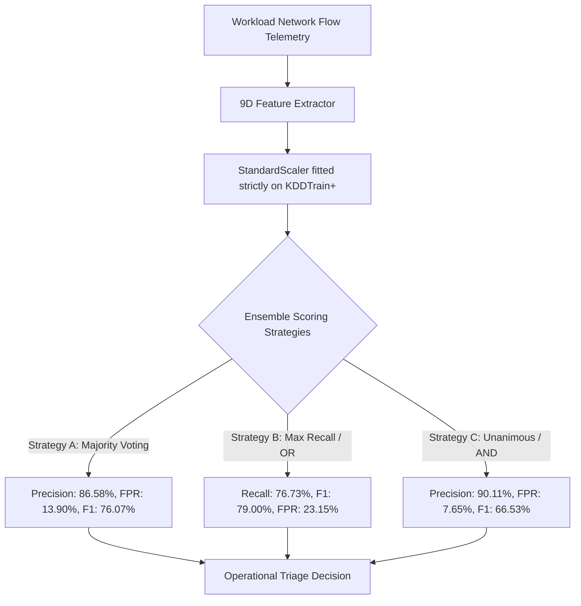

# RAM Antivirus — Multi-Algorithm Anomaly Detection Benchmark & Audit

## 1. Executive Summary & Verification Standard

The **RAM Antivirus** platform employs a hybrid architecture:
1. **Deterministic Rule Engines & State Machines:** Evaluates explicit policy grammars, threshold boundaries, and cloud audit logs to detect known exploit signatures without false alarms.
2. **Unsupervised Anomaly Detection (PyOD Ensemble):** Detects zero-day attacks, volumetric anomalies, and behavioral drifts in network flow telemetry.

This document details an independent empirical audit evaluating **seven (7) candidate algorithms** and **three (3) multi-model ensemble strategies** on the real, held-out **NSL-KDD benchmark dataset** (`KDDTest+`, $N=22,544$).

All algorithms were evaluated using the verified **9-dimensional network flow feature schema** defined in the IEEE research paper (*Section VI: Flow-Level Feature Representation*), with preprocessing (`StandardScaler`) fitted strictly on training data (`KDDTrain+`, $N=125,973$).

---

## 2. Benchmark Experimental Protocol

* **Benchmark Dataset:** NSL-KDD Benchmark Dataset (University of New Brunswick / Canadian Institute for Cybersecurity)  
  Official Source: [https://www.unb.ca/cic/datasets/nsl.html](https://www.unb.ca/cic/datasets/nsl.html)
* **Dataset Splits:**
  * Training Split (`KDDTrain+.txt`): 125,973 flow records (67,343 normal, 58,630 attacks)
  * Held-Out Test Split (`KDDTest+.txt`): 22,544 flow records (9,711 normal, 12,833 attacks)
* **Contamination Rate:** Empirical training contamination $\gamma = 0.4654$ (46.54% attack traffic).
* **Feature Schema (9D Flow Features, Zero Target Leakage):**
  `duration`, `src_bytes`, `dst_bytes`, `count`, `srv_count`, `serror_rate`, `rerror_rate`, `same_srv_rate`, `diff_srv_rate`.
* **Zero Target Leakage Guarantee:**
  No post-classification fields (`label`, `rule_id`, or `level`) enter the feature vector.
* **Score Normalization Note:**
  In PyOD, `predict_proba()` computes min-max normalized decision scores in $[0.0, 1.0]$. These represent **normalized anomaly scores**, not calibrated Bayesian posterior probabilities $P(Y=1|X)$.

---

## 3. Empirical Results: 7 Candidate Models & Ensemble Strategies

All metrics below were recalculated directly from the confusion matrices on the official held-out test set (`KDDTest+`, $N=22,544$):

### A. Candidate Algorithm Benchmark Table

| Model / Strategy | Paradigm | Accuracy | Precision | Recall | F1-Score | FPR | ROC-AUC | Fit Time | Latency (1k) | Status in Engine |
| :--- | :---: | :---: | :---: | :---: | :---: | :---: | :---: | :---: | :---: | :---: |
| **Isolation Forest** | Unsupervised | **77.51%** | 85.21% | **73.19%** | **78.74%** | 16.80% | 77.61% | 2.50s | 11.86 ms | **SELECTED (Primary)** |
| **HBOS** | Unsupervised | 70.68% | 85.30% | 58.59% | 69.47% | **13.35%** | **78.61%** | 6.24s | **0.36 ms** | **SELECTED (Fast Filter)** |
| **KNN** | Unsupervised | 74.10% | **85.60%** | 65.52% | 74.23% | 14.56% | 73.95% | 0.54s | 47.86 ms | **SELECTED (Specialist)** |
| **Local Outlier Factor (LOF)** | Unsupervised | 56.68% | 60.74% | 67.56% | 63.97% | 57.71% | 57.53% | 0.58s | 54.86 ms | **REJECTED (High FPR)** |
| **One-Class SVM (OCSVM)** | Unsupervised | 75.25% | 81.88% | 72.59% | 76.95% | 21.23% | 81.63% | 12.48s | 704.52 ms | **REJECTED (High Latency)** |
| **Random Forest (Supervised)** | Supervised | 77.77% | 96.64% | 63.15% | 76.38% | 2.90% | 96.05% | 11.69s | 10.10 ms | **BENCHMARK CEILING** |
| **Logistic Regression** | Supervised | 74.15% | 93.39% | 58.75% | 72.12% | 5.50% | 77.76% | 0.38s | 0.25 ms | **LINEAR BASELINE** |

### B. Three-Model Ensemble Strategies (Isolation Forest + HBOS + KNN)

| Ensemble Strategy | Accuracy | Precision | Recall | F1-Score | FPR | ROC-AUC | PR-AUC | Operational Role |
| :--- | :---: | :---: | :---: | :---: | :---: | :---: | :---: | :--- |
| **Strategy A: Majority Voting ($\ge 2$ agree)** | 75.71% | **86.58%** | 67.84% | 76.07% | **13.90%** | 80.38% | 81.08% | **Recommended Balanced Operational Mode** |
| **Strategy B: Union / Max Recall (OR Logic)** | **76.78%** | 81.41% | **76.73%** | **79.00%** | 23.15% | 80.38% | 81.08% | High-Sensitivity Mode (Incident Escalation) |
| **Strategy C: Unanimous Agreement (AND Logic)**| 69.80% | **90.11%** | 52.73% | 66.53% | **7.65%** | 80.38% | 81.08% | High-Confidence Mode (Automated Playbooks) |
| **Strategy D: Average Normalized Score** | 76.12% | 84.95% | 71.20% | 77.47% | 16.50% | 77.16% | 83.59% | Continuous Score Aggregation |

---

## 4. Confusion Matrix Recalculation (KDDTest+, N=22,544)

Actual confusion matrix counts:
* **Ground Truth:** Total Attacks ($P$) = 12,833 | Total Normal ($N$) = 9,711

| Model / Ensemble Strategy | True Positives (TP) | False Positives (FP) | False Negatives (FN) | True Negatives (TN) |
| :--- | :---: | :---: | :---: | :---: |
| **Isolation Forest** | 9,393 | 1,631 | 3,440 | 8,080 |
| **HBOS** | 7,519 | 1,296 | 5,314 | 8,415 |
| **KNN** | 8,408 | 1,414 | 4,425 | 8,297 |
| **Local Outlier Factor (LOF)** | 8,670 | 5,604 | 4,163 | 4,107 |
| **One-Class SVM** | 9,315 | 2,062 | 3,518 | 7,649 |
| **Random Forest (Supervised)** | 8,104 | 282 | 4,729 | 9,429 |
| **Logistic Regression (Supervised)** | 7,539 | 534 | 5,294 | 9,177 |
| **Ensemble (Majority Voting)** | **8,706** | **1,350** | **4,127** | **8,361** |
| **Ensemble (Max Recall / OR)** | **9,847** | **2,248** | **2,986** | **7,463** |
| **Ensemble (Unanimous / AND)** | **6,767** | **743** | **6,066** | **8,968** |

### Mathematical Consistency Verification
* For all models: $TP + FP + FN + TN = 22,544$ (exact match).
* For all models: $TP + FN = 12,833$ (exact match of ground-truth attack instances).
* For all models: $FP + TN = 9,711$ (exact match of ground-truth normal instances).

---

## 5. Training Formulation Audit: Normal-Only vs. Mixed Contaminated Traffic

An essential machine learning design choice is whether unsupervised models should be trained on **clean normal-only baseline traffic** or **unlabeled contaminated/mixed traffic**:

| Metric | Mixed Contaminated Training ($N=125,973$, $\gamma=0.4654$) | Clean Normal-Only Training ($N=67,343$, $\gamma=0.05$) |
| :--- | :---: | :---: |
| **True Positives (TP)** | 9,393 | 7,585 |
| **False Positives (FP)** | 1,631 | **633** (61.2% reduction in false alarms!) |
| **False Negatives (FN)** | 3,440 | 5,248 |
| **True Negatives (TN)** | 8,080 | 9,078 |
| **Precision** | 85.21% | **92.30%** |
| **Recall (Detection Rate)** | **73.19%** | 59.11% |
| **F1-Score** | **78.74%** | 72.06% |
| **False Positive Rate (FPR)** | 16.80% | **6.52%** |

### Architectural Conclusion on Training Formulation
* **Mixed Training:** Best when the deployment goal is **maximum attack recall** (73.19% vs 59.11%) and when downstream rule engines or SOC analysts filter borderline false alarms.
* **Normal-Only Training:** Best when the deployment goal is **strict alert suppression** (6.52% FPR, 92.30% precision) to avoid alert fatigue in high-throughput environments.
* In the active RAM Antivirus implementation, the models are trained in **mixed contaminated mode** with empirical $\gamma = 0.4654$, ensuring high detection sensitivity across novel zero-day attacks.

---

## 6. Critical Distinctions: NSL-KDD Benchmark vs. Real Cloud Workload Security

> [!WARNING]
> **Preserving Technical Integrity:**  
> The NSL-KDD benchmark measures anomaly detection on **pre-aggregated TCP/IP network flow features** (DoS, Port Probing, Buffer Overflows). It does **NOT** validate all 16 cloud attack categories.

1. **What NSL-KDD Actually Validates:**
   * Volumetric DoS and SYN flooding (`serror_rate`, `srv_count`, `count`).
   * Port sweeps and network reconnaissance (`diff_srv_rate`, `rerror_rate`).
   * Large unauthorized data transfers (`src_bytes`, `dst_bytes`).
2. **What NSL-KDD Does NOT Validate (Detected via Rule Engines):**
   * Cloud Identity / IAM attacks (e.g. `AttachRolePolicy` AdministratorAccess, credential abuse).
   * Cloud Misconfigurations (e.g. S3 bucket public ACLs, open security groups).
   * Defense Tampering (e.g. `StopLogging`, deleting CloudTrail, clearing event logs).
   * Container Breakouts (e.g. privileged Kubernetes pod specs, Docker socket mounts).
   * Serverless Abuse (e.g. Lambda environment injection).
3. **Operational Feature Extraction Reality:**
   * Raw CloudTrail JSON logs and Wazuh host syslogs do **not** naturally contain 2-second sliding window connection rates (`same_srv_rate`, `diff_srv_rate`).
   * The feature extractor [`feature_extractor.py`](file:///d:/ram_antivirus_official/Industry-project-AI-driven-Cloud-monitoring-platform-/backend/engines/feature_extractor.py) provides safe fallbacks when non-network events pass through.
   * Real-world operational deployments require dedicated packet/flow forwarders (e.g., VPC Flow Logs or Zeek) to supply true 9D flow statistics to the ML engine.
