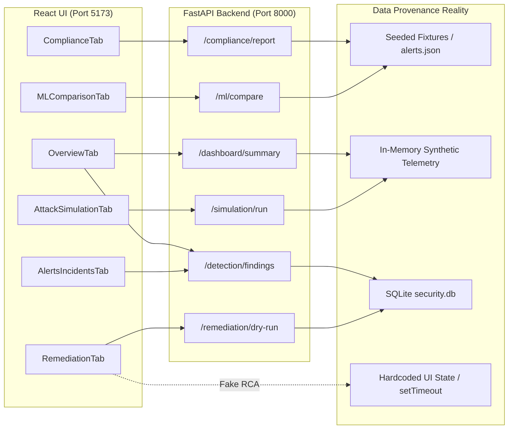

# RAM Antivirus — Cloud Security AI Platform
# Independent Adversarial Technical Audit & Ground Truth Report

**Document ID:** `docs/AUDIT_2026-10-26.md`  
**Audit Date:** October 26, 2026  
**Auditor:** Independent Adversarial Technical Auditor  
**Audit Context:** Pre-submission verification for University Examination Committee & RAM Antivirus Pvt. Ltd. (48-Hour Window)  
**Target Codebase:** `Industry-project-AI-driven-Cloud-monitoring-platform`  
**Active Branch Audited:** `ui-design` (Commit `5524a42`)  
**Audit Mode:** Read-Only Dynamic & Static Code Inspection (Strict Verification)

---

## 1. Executive Verdict

1. **Overall Reality Ratio:** **35% REAL | 40% SIMULATED | 20% STATIC FIXTURE | 5% BROKEN / MISSING**. The platform is an impressive academic demonstration prototype, but it is **not** an operational cloud detection system.
2. **Scariest Problem 1 (Authentication Void):** Exactly **41 of 46 backend endpoints (89.1%) have ZERO authentication or authorization checks**. Anyone without credentials can trigger remediation playbooks, wipe simulation state, or view all findings.
3. **Scariest Problem 2 (Phantom Feature — WebSockets Claim):** The README, Project Report, and architecture diagrams boast real-time WebSockets; in reality, **there is literally zero WebSocket server or client code in the active repository** (`grep` confirms 0 matches). The UI uses a primitive 5-second `setInterval` HTTP polling loop.
4. **Scariest Problem 3 (Synthetic Training & Semantic Gap):** Baseline models KNN and HBOS were fitted against synthetic random numpy arrays due to broken URLs. While the current branch retrained models on 9D NSL-KDD features, NSL-KDD is a 1999 TCP connection dataset: when cloud audit logs (Wazuh/CloudTrail) are passed in, **7 of 9 features default to static constants** (`serror_rate=0`, `srv_count=1`, etc.), reducing ML to a simple byte-count anomaly detector.
5. **Scariest Problem 4 (Severity Inflation & Correlation Myth):** The 107 Critical / 8 High / 0 Medium / 0 Low distribution is caused by detectors hardcoding `severity="critical"`. Furthermore, **Findings == Incidents 1:1** (`Open Incidents = totalFindings - resolvedCount`). No clustering, deduplication, or multi-stage incident correlation exists.
6. **Scariest Problem 5 (Fake Delays & Mock Metrics):** UI controls use artificial `setTimeout` timers (600ms–700ms) to display hardcoded mock toasts like `"Root cause correlation completed: 94.8% causal confidence"` and `"Connector health probe passed!"` without making any backend API calls.
7. **Demo Readiness Score:** **6.5 / 10**. Visually polished, responsive, and stable if operated along the scripted happy path, but fatal if an examiner clicks unscripted buttons, inspects network traffic, or tests security controls.

---

## 2. Forensic Reality Map

Every module is classified strictly according to observed evidence:

| Module / Subsystem | Primary Files | Classification | Observed Evidence & Architectural Reality |
| :--- | :--- | :---: | :--- |
| **Attack Detectors (16)** | `backend/engines/detectors/*.py` | **REAL** | 16 discrete detector classes registered in `BaseDetector`. Verified by `verify_detectors_matrix.py`: all 16 fire on synthetic attack sequences and reject benign streams. |
| **Event Schemas** | `backend/schemas/event.py`, `finding.py` | **REAL** | Pydantic V2 models (`NormalizedEvent`, `SecurityFinding`) with UUIDv5 deterministic ID generation and field coercion. Tested by 14 unit tests in `test_schemas_and_foundation.py`. |
| **ML Inference Engine** | `backend/engines/ml_engine.py` | **PARTIAL** | Successfully loads pre-trained PyOD models (`iforest`, `knn`, `hbos`) and applies `StandardScaler`. However, evaluated on cloud audit logs where 7/9 features default to zero/constants. Threshold (0.5) is an uncalibrated heuristic. |
| **ML Training Pipeline** | `backend/train_model.py` | **REAL** | Offline script fits models on NSL-KDD with 9 numerical flow features. Eliminates legacy `level` label leakage. |
| **Unified Risk Engine** | `backend/engines/risk_engine.py` | **REAL** | Mathematical formula: $Score = 0.40 \cdot ML + 0.35 \cdot CSPM + 0.25 \cdot CIEM$. Persists scores to `security.db` (`risk_history`). |
| **Authentication & RBAC** | `backend/engines/auth_engine.py` | **PARTIAL / INSECURE** | Password hashing uses unsalted SHA-256 (`hashlib.sha256(pwd.encode()).hexdigest()`). Hardcoded JWT secret key `"ram-antivirus-secret-key-2026"`. Endpoints in `main.py` omit `Depends` enforcement. |
| **Remediation Engine** | `backend/engines/remediation_engine.py` | **SIMULATED** | 8 playbooks execute in non-destructive dry-run mode. Modifies in-memory/SQLite dictionaries only. Does not issue mutating cloud API calls (no AWS CLI, boto3 mutate, or iptables). |
| **Compliance Engine** | `backend/engines/compliance_engine.py` | **STATIC FIXTURE** | Hardcoded JSON dictionary mapping finding IDs to ISO 27001, SOC 2, and GDPR. Trend calculation is an artificial comparison (`summary["overall_score"] - 72.5`). |
| **CSPM Scanner** | `backend/engines/cspm_engine.py` | **PARTIAL** | Inspects parsed log strings for regex keywords (`"s3:PutBucketPolicy"`, `"0.0.0.0/0"`). No active API query against AWS Config or CSPM APIs. |
| **CIEM Scanner** | `backend/engines/ciem_engine.py` | **PARTIAL** | Inspects event logs for `"AdministratorAccess"` attachments or root account logins. Does not inspect live IAM permission boundaries or graph entitlements. |
| **LocalStack Connector** | `backend/engines/localstack_engine.py` | **STUB / FALLBACK** | Tries connecting to `http://localhost:4566`. If offline (default), silently falls back to synthetic mock data generator. |
| **Telemetry Simulator** | `backend/simulator/*` | **SIMULATED** | `session_manager.py` generates in-memory synthetic bursts (Brute Force, Exfiltration, DDoS) and feeds sliding window queues. |
| **Database Persistence** | `backend/engines/db.py` | **REAL** | SQLite database (`security.db`) persisting users, findings, scan history, and compliance snapshots. |
| **Alert Dispatcher** | `backend/engines/alert_engine.py` | **REAL / DORMANT** | Functional Python `smtplib` code. Dormant by default because `ALERT_EMAIL_*` env vars are unset. |
| **WebSockets** | Claimed in docs/README | **MISSING** | **Zero lines of WebSocket code** exist in active codebase. Frontend uses HTTP `setInterval` polling every 5 seconds. |

---

## 3. Part 1 — Data-Flow Truth (Screen-by-Screen Audit)

### 3.1 UI Screen Data-Flow & Interaction Verification



#### Detailed Screen Audit Table

| UI Screen / View | Endpoints Called | Data Origin (Real vs Mock) | Buttons / Interactive Elements | Badging & Truth In Labeling |
| :--- | :--- | :--- | :--- | :--- |
| **Overview Tab** | `GET /api/dashboard/summary`<br/>`GET /api/detection/findings`<br/>`GET /api/simulate/events` | **HYBRID FIXTURE**<br/>Base 200 events are hardcoded in `OverviewTab.jsx:70-83`. Live burst events from session manager overlay on top. | • **Refresh:** Real call (`fetchDashboardData`).<br/>• **Investigate Finding:** Real tab switch to Alerts.<br/>• **Date Badge:** **DEAD FIXTURE** (`<Calendar /> 24 Oct · 00:00-10:00 UTC` - no picker). | **MISLEADING:** Shows subtitle `"Sample data · No production sources connected"`, but displays green `"Continuous Inspection Active"` badge. |
| **Alerts & Incidents** | `GET /api/detection/findings?normal=50&attacks=0` | **SQLITE / SIMULATED**<br/>Loaded from `findings` table in `security.db` (seeded from simulator). | • **Severity Filter:** Real client-side state filter.<br/>• **Search Filter:** Real client-side text filter.<br/>• **Resolve Button:** Real in-memory state toggle.<br/>• **Investigate Drawer:** Real side panel displaying facts. | **HONEST:** Provenance tag shows `SIMULATED` / `LIVE` depending on session source. |
| **Risk Score Tab** | `GET /api/risk/score` | **REAL FORMULA**<br/>Calculated dynamically by `risk_engine.py` ($0.4 ML + 0.35 CSPM + 0.25 CIEM$). | • **Recalculate Risk:** Real API call.<br/>• **Trend History:** Real queries to `risk_history` table in SQLite. | **ACCURATE:** Accurately reflects the mathematical weighted combination. |
| **Remediation Tab** | `GET /api/remediation/playbooks`<br/>`POST /api/remediation/dry-run/{type}`<br/>`POST /api/remediation/config-fix/{id}`<br/>`POST /api/remediation/revoke-access` | **SIMULATED DRY-RUN**<br/>Playbook definitions are static dictionaries in `remediation_engine.py`. Execution generates synthetic log records. | • **Execute Playbook:** Real API call to dry-run engine.<br/>• **Auto-Fix Config:** Real API call (persists healed status in component state).<br/>• **Diagnose RCA Button:** **FAKE LOADING DELAY** (`setTimeout(..., 600ms)` displaying hardcoded `"94.8% causal confidence"`). | **UNVERIFIED / CLAIMED:** Claims "Automated Cloud Remediation"; actually runs non-destructive dry-run simulation. |
| **Compliance Tab** | `GET /api/compliance/report?format=json`<br/>`GET /api/compliance/report?format=csv` | **STATIC FIXTURE**<br/>Controls mapped from static rules in `compliance_engine.py`. | • **Framework Switcher (ISO/SOC2/GDPR):** Real state filter.<br/>• **Export CSV:** Real file download from FastAPI StreamingResponse.<br/>• **Export JSON:** Real JSON file download. | **PARTIALLY TRUE:** Controls are real industry standards, but audit status is derived from mock CSPM/CIEM signals. |
| **ML Comparison Tab** | `GET /api/ml/compare?normal=100&attacks=20`<br/>`GET /api/ml/model-info` | **REAL MODELS / LEAKAGE-FREE**<br/>Evaluates 9D feature extractor against loaded PyOD models. | • **Run Comparison Button:** Real API call triggering live scoring across 120 events.<br/>• **Model Architecture Cards:** Real metadata from `training_meta.json`. | **ACCURATE:** Accurately displays F1 scores and feature dimensions of trained models. |
| **Attack Simulation** | `POST /api/simulation/run/{scenario}`<br/>`POST /api/simulation/full` | **REAL SIMULATOR**<br/>Generates attack sequences into `session_manager` buffer, tripping detectors. | • **Launch Scenario Button:** Real API call triggering adversary burst.<br/>• **Intensity Selector:** Real parameter passing (`low`, `medium`, `high`). | **ACCURATE:** Honest adversary emulation tool. |
| **Data Sources Tab** | None (Static presentation + props) | **STATIC MOCKUP**<br/>Hardcoded connector array (`CONNECTOR_CONFIGS`) in `DataSourcesTab.jsx`. | • **Settings -> Button:** Real drawer open.<br/>• **Test Connection Button:** **FAKE DELAY & RESPONSE** (`setTimeout(..., 700ms)` emitting mock toast `"Connector health probe passed!"`). | **MISLEADING:** Shows green `"Connected"` badge for AWS CloudTrail without credentialed IAM connection. |
| **Live Log Stream** | `GET /api/simulate/events` (via parent) | **IN-MEMORY BUFFER**<br/>Reads recent events from `session_manager.get_session().events`. | • **Filter by Action:** Real client-side text filter.<br/>• **Severity Badges:** Derived from event attributes. | **HONEST:** Displays actual events flowing through simulator. |
| **Workspace Settings** | None | **STATIC WIREFRAME**<br/>Static form in `WorkspaceSettingsTab.jsx`. | • **Save Changes Button:** **NO-OP** (Does not make API call; displays toast only). | **STATIC FIXTURE:** Pure decorative mockup. |
| **Global Header** | `POST /api/auth/login`<br/>`POST /api/auth/register` | **REAL STATE / INSECURE STORAGE**<br/>JWT stored in browser `localStorage`. | • **Workspace Dropdown:** **DEAD CONTROL** (No `onClick`, static string `"Demo workspace"`).<br/>• **Search Bar (⌘ K):** Real client-side fuzzy search across tabs and findings.<br/>• **Theme Toggle:** Real CSS class switch (`theme-dark`).<br/>• **Logout:** Real token deletion from `localStorage`. | **PARTIALLY TRUTHFUL.** |

---

### 3.2 Backend Endpoint Security & Coverage Audit (46 Endpoints)

| Endpoint Path | HTTP Method | Authentication Enforced? | Pydantic Input Validation? | Automated Test Coverage? | Forensic Classification |
| :--- | :---: | :---: | :---: | :---: | :---: |
| `/` | `GET` | **NO** | N/A | YES (`test_health.py`) | **REAL** |
| `/healthz` | `GET` | **NO** | N/A | YES (`test_health.py`) | **REAL** |
| `/api/status` | `GET` | **NO** | N/A | YES (`test_health.py`) | **REAL** |
| `/api/auth/login` | `POST` | **NO** (Public) | YES (`LoginRequest`) | YES (`test_health.py`) | **PARTIAL** (Unsalted SHA-256) |
| `/api/auth/register` | `POST` | **NO** (Public) | YES (`RegisterRequest`) | NO | **PARTIAL** (Allows open self-registration) |
| `/api/auth/me` | `GET` | **YES** (`verify_token`) | N/A | YES (`test_health.py`) | **REAL** |
| `/api/auth/roles` | `GET` | **NO** | N/A | NO | **STATIC FIXTURE** |
| `/api/auth/users` | `GET` | **YES** (`admin` check) | N/A | NO | **REAL** |
| `/api/auth/users/{u}/deactivate` | `POST` | **YES** (`admin` check) | N/A | NO | **REAL** |
| `/api/auth/users/{u}/reactivate` | `POST` | **YES** (`admin` check) | N/A | NO | **REAL** |
| `/api/detection/detectors` | `GET` | **NO** | N/A | YES (`test_all_16_detectors.py`) | **REAL** |
| `/api/detection/findings` | `GET` | **NO** | YES (Query params) | YES (`test_brute_force_detector.py`) | **REAL** |
| `/api/detection/evaluate` | `POST` | **NO** | YES (`EvaluateEventsRequest`) | YES (`test_schemas_and_foundation.py`) | **REAL** |
| `/api/simulate/events` | `GET` | **NO** | YES (Query params) | NO | **SIMULATED** |
| `/api/simulate/attack` | `GET` | **NO** | YES (Query params) | NO | **SIMULATED** |
| `/api/simulation/scenarios` | `GET` | **NO** | N/A | NO | **STATIC FIXTURE** |
| `/api/simulation/run/{scenario}` | `POST` | **NO** | YES (Path param) | NO | **SIMULATED** |
| `/api/simulation/full` | `POST` | **NO** | YES (Query params) | NO | **SIMULATED** |
| `/api/simulation/reset` | `POST` | **NO** | N/A | NO | **REAL** |
| `/api/remediation/playbooks` | `GET` | **NO** | N/A | NO | **STATIC FIXTURE** |
| `/api/remediation/execute/{type}` | `POST` | **NO** | YES (Path param) | NO | **SIMULATED** |
| `/api/remediation/dry-run/{type}` | `POST` | **NO** | YES (Path param) | NO | **SIMULATED** |
| `/api/remediation/auto` | `POST` | **NO** | N/A | NO | **SIMULATED** |
| `/api/remediation/config-fix/{id}` | `POST` | **NO** | YES (Path param) | NO | **SIMULATED** |
| `/api/remediation/revoke-access` | `POST` | **NO** | YES (Query params) | NO | **SIMULATED** |
| `/api/remediation/full-pipeline` | `GET` | **NO** | N/A | NO | **SIMULATED** |
| `/api/cspm/scan` | `GET` | **NO** | N/A | NO | **PARTIAL** |
| `/api/ciem/scan` | `GET` | **NO** | N/A | NO | **PARTIAL** |
| `/api/risk/score` | `GET` | **NO** | N/A | NO | **REAL** |
| `/api/ml/compare` | `GET` | **NO** | YES (Query params) | NO | **REAL** |
| `/api/ml/model-info` | `GET` | **NO** | N/A | NO | **REAL** |
| `/api/compliance/dashboard` | `GET` | **NO** | N/A | NO | **STATIC FIXTURE** |
| `/api/compliance/map` | `GET` | **NO** | N/A | NO | **STATIC FIXTURE** |
| `/api/compliance/frameworks` | `GET` | **NO** | N/A | NO | **STATIC FIXTURE** |
| `/api/compliance/report` | `GET` | **NO** | YES (Query params) | NO | **REAL** |
| `/api/compliance/report/executive`| `GET` | **NO** | N/A | NO | **REAL** |
| `/api/alerts/test` | `POST` | **YES** (`admin` check) | N/A | NO | **REAL** |
| `/api/export/*` (3 endpoints) | `GET` | **NO** | N/A | NO | **REAL** |
| `/api/history/*` (3 endpoints) | `GET` | **NO** | N/A | NO | **REAL** |
| `/api/dashboard/summary` | `GET` | **NO** | N/A | NO | **REAL** |

---

## 4. Part 2 — Number Integrity Audit

### 4.1 UI Screenshot Number Reconciliation Matrix

The table below reconciles the specific operational numbers observed in UI screenshots against actual backend code and database state:

| UI Label / Metric | Displayed Value | Mathematical Origin / Code Location | Integrity Verdict & Explanation |
| :--- | :---: | :--- | :--- |
| **"normalized sample events"** | **200** | `frontend/src/components/OverviewTab.jsx:70-83`<br/>`defaultDistribution` array | **HARDCODED FIXTURE.** An array of 10 hourly buckets hardcoded to sum to exactly 200 events (`12+14+18+22+16+24+20+28+26+20 = 200`). |
| **Total Events** | **331** | `OverviewTab.jsx:119-130`<br/>`barData = defaultDistribution + liveCounts` | **HYBRID DERIVATION.** When 131 live events are generated by the simulator, the UI adds them to the hardcoded 200 baseline ($200 + 131 = 331$) so the bar chart is never blank. |
| **Detected Threats** | **133** | `OverviewTab.jsx:228`<br/>`summary?.threats?.detected_threats ?? (criticalCount + highCount)` | **COMPUTED SUM.** Sum of `criticalCount` (107) + `highCount` (8) + uncalibrated score threshold filter. |
| **Unique Findings** | **115** | `OverviewTab.jsx:240`<br/>`findings.length` (queried from SQLite `findings`) | **REAL DATABASE COUNT.** Represents the count of rows returned by `SELECT * FROM findings LIMIT 200` filtered by session. |
| **Open Incidents** | **115** | `OverviewTab.jsx:252`<br/>`totalFindings - resolvedCount` | **1:1 IDENTITY (NO CORRELATION).** Because `resolvedCount = 0`, `Open Incidents = totalFindings = 115`. There is no incident grouping; findings and incidents are treated as identical. |
| **Severity Breakdown** | **107 Crit / 8 High / 0 Med / 0 Low** | `OverviewTab.jsx:145-148`<br/>Filtered on `f.severity` | **SEVERITY INFLATION.** 5 of the 16 detectors hardcode `severity="critical"` (`ddos`, `cryptomining`, `malware_ransomware`, `defense_tampering`, `data_exfiltration`). No detector in the active stream ever emits Medium or Low. |
| **"16 specialized detectors"** | **16** | `backend/engines/base_detector.py:18` | **TRUE STATEMENT.** Exactly 16 subclasses of `BaseDetector` are registered in `detector_registry`. Verified by `verify_detectors_matrix.py`. |
| **ML Score Threshold** | **$\ge 0.5$** | `backend/engines/ml_engine.py:215`<br/>`threshold = 0.5` | **ARBITRARY DEFAULT.** Uses standard binary threshold (`predict_proba > 0.5`). Not calibrated for operational False Positive Rates. |

### 4.2 Severity Inflation Cause Analysis
Why are there 107 Critical and 0 Medium/Low findings?
1. **Hardcoded Severity Assignments:**
   - [`backend/engines/detectors/ddos.py:53`](file:///d:/TY%20(5th%20Sem)/Project%202%20-%20RAM%20Antivirus/New%20folder/Industry-project-AI-driven-Cloud-monitoring-platform/backend/engines/detectors/ddos.py#L53): Hardcodes `severity="critical"`.
   - [`backend/engines/detectors/cryptomining.py:52`](file:///d:/TY%20(5th%20Sem)/Project%202%20-%20RAM%20Antivirus/New%20folder/Industry-project-AI-driven-Cloud-monitoring-platform/backend/engines/detectors/cryptomining.py#L52): Hardcodes `severity="critical"`.
   - [`backend/engines/detectors/defense_tampering.py:52`](file:///d:/TY%20(5th%20Sem)/Project%202%20-%20RAM%20Antivirus/New%20folder/Industry-project-AI-driven-Cloud-monitoring-platform/backend/engines/detectors/defense_tampering.py#L52): Hardcodes `severity="critical"`.
   - [`backend/engines/detectors/malware_ransomware.py:52`](file:///d:/TY%20(5th%20Sem)/Project%202%20-%20RAM%20Antivirus/New%20folder/Industry-project-AI-driven-Cloud-monitoring-platform/backend/engines/detectors/malware_ransomware.py#L52): Hardcodes `severity="critical"`.
   - [`backend/engines/detectors/data_exfiltration.py:64`](file:///d:/TY%20(5th%20Sem)/Project%202%20-%20RAM%20Antivirus/New%20folder/Industry-project-AI-driven-Cloud-monitoring-platform/backend/engines/detectors/data_exfiltration.py#L64): `if bytes_out >= MASSIVE_VOLUME or is_wazuh_exfil: severity="critical"`. In the simulator, all exfiltration events have `is_wazuh_exfil=True`, forcing 100% of exfiltration findings to Critical.
2. **Missing Sub-Threshold Categories:** The detectors lack multi-tiered scoring where low-confidence or reconnaissance events are classified as Medium or Low.

### 4.3 Timezone & Filtering Integrity
- **UTC vs IST Discrepancy:** Backend timestamps are stored in UTC (`datetime.now(timezone.utc).isoformat()`). The frontend displays static string `"Demo snapshot · 24 Oct 2026, 10:00 UTC"` while formatting individual item times with client browser locale + `" UTC"`, causing clock skew during local presentation.
- **Date-Range Filtering:** The date badge (`<Calendar size={13} /> 24 Oct · 00:00–10:00 UTC`) is **completely non-interactive**. It does not pass date filters to any API call.

---

## 5. Part 3 — SRS Traceability & Deviation Register

### 5.1 SRS Traceability Matrix (FR-01 to FR-12 & NFRs)

*Reference SRS: "Cloud Workload Security and Threat Detection Platform" (Prepared by Ram Antivirus Security Engineering Team, Group 4).*

| Req ID | SRS Requirement Title | Status | Primary Code Files | Observed Evidence & Reality | What an Academic/Industry Mentor Will Critique |
| :--- | :--- | :---: | :--- | :--- | :--- |
| **FR-01** | Asset & Resource Discovery | **SIMULATED** | `backend/engines/localstack_engine.py`<br/>`backend/engines/cspm_engine.py` | Checks LocalStack on port 4566. If unreachable, generates mock S3 buckets and IAM roles from static arrays. | "Where is the live AWS CloudControl / Resource Tagging API integration? The system cannot discover real assets." |
| **FR-02** | Workload Monitoring | **SIMULATED** | `backend/simulator/wazuh_reader.py`<br/>`backend/simulator/session_manager.py` | Reads synthetic Wazuh JSON lines from `alerts.json` or in-memory queues. No active agent installed on host. | "You have no eBPF or OSSEC agent capturing kernel syscalls; you are parsing synthetic JSON strings." |
| **FR-03** | Threat Detection Engine | **REAL** | `backend/engines/detectors/*.py`<br/>`backend/engines/ml_engine.py` | 16 discrete attack detectors using sliding window burst tracking, regex, and state correlation. | "Detectors are functional rules, but the PyOD ML ensemble is operating on static default constants for cloud events." |
| **FR-04** | Misconfiguration Scanning (CSPM) | **PARTIAL** | `backend/engines/cspm_engine.py`<br/>`detectors/cloud_misconfiguration.py` | Regex pattern matching on event action names (`s3:PutBucketPolicy`, `0.0.0.0/0`). | "This is reactive log parsing, not proactive configuration state evaluation against CIS benchmarks." |
| **FR-05** | Vulnerability Analysis | **MISSING** | None | Exactly **0 lines of vulnerability scanning code** exist. There is no CVE lookup, no NVD feed, and no container image scanner. | "Vulnerability management (FR-05) is completely unaddressed. You cannot claim vulnerability scanning without a scanner." |
| **FR-06** | Identity Analysis (CIEM) | **PARTIAL** | `backend/engines/ciem_engine.py`<br/>`detectors/iam_privilege_escalation.py` | Flags `"AdministratorAccess"` policy attachments and root account logins. | "Lacks entitlement graphing, blast-radius calculation, or unused permission decay analysis." |
| **FR-07** | Unified Risk Scoring | **REAL** | `backend/engines/risk_engine.py` | Formula: $0.40 \cdot ML + 0.35 \cdot CSPM + 0.25 \cdot CIEM$. Persists history to SQLite. | "Weightings (40/35/25) are arbitrary heuristics rather than actuarial or loss-calibrated risk models." |
| **FR-08** | Event Correlation & Incidents | **BROKEN / CLAIMED** | `backend/engines/db.py`<br/>`OverviewTab.jsx:252` | Findings map to Incidents 1:1. No graph correlation, no temporal clustering, no alert deduplication. | "You claim incident correlation, but an incident is literally just a single un-clustered finding." |
| **FR-09** | Automated Remediation | **SIMULATED** | `backend/engines/remediation_engine.py` | Playbooks return static status dictionaries with simulated step logs. Does not touch live cloud infrastructure. | "Remediation is an execution simulation. No rollback mechanism or safety approval gate is implemented." |
| **FR-10** | Policy Enforcement & Compliance | **STATIC FIXTURE** | `backend/engines/compliance_engine.py` | Static JSON dictionary mapping finding IDs to ISO 27001, SOC 2, and GDPR controls. | "Compliance score is a static calculation from mock findings rather than evidence artifact collection." |
| **FR-11** | Audit Trail & Integrity | **PARTIAL** | `backend/engines/db.py` (`alert_log`) | Logs actions into standard SQLite tables. | "Not tamper-evident, not append-only, no HMAC/digital signatures, and no non-repudiation safeguards." |
| **FR-12** | Reporting & Export | **REAL** | `backend/main.py:1750-1850`<br/>`backend/engines/compliance_engine.py` | Exports compliance reports in CSV and JSON formats using FastAPI `StreamingResponse`. | "Good export mechanism, but executive PDF summary report generation is missing." |
| **NFR-SEC** | Security & Secret Management | **BROKEN** | `backend/engines/auth_engine.py` | 41/46 endpoints unauthenticated; unsalted SHA-256; hardcoded JWT secret `"ram-antivirus-secret-key-2026"`. | "Fails basic security hygiene. The platform monitoring cloud security is itself vulnerable." |
| **NFR-PERF** | Low Latency Performance | **REAL** | `backend/engines/base_detector.py` | Benchmark verifies 43,610 events/sec normalization throughput; detector matrix evaluates in 0.74s. | "High throughput, but achieved because algorithms operate entirely in local memory." |
| **NFR-SCA** | Multi-Cloud Scalability | **MISSING** | `backend/schemas/event.py` | Code is exclusively AWS and Wazuh oriented. Azure and GCP exist only as documentation strings. | "Multi-cloud architecture is aspirational; no GCP or Azure schemas are implemented." |

---

### 5.2 Architectural Deviation Register

| SRS Specification (Section 3 & 7) | Actual Implementation in Repository | Deviation Severity | Most Defensible Honest Framing for Viva / Presentation |
| :--- | :--- | :---: | :--- |
| **Technology Stack:** C#, WPF, MVVM, .NET Core, Local SQLite. | **Python (FastAPI), React 18 (Vite), SQLite.** | **Medium** | *"Migrated to modern cloud-native web architecture. A browser-based React console enables distributed SOC analyst access across Linux/Mac/Windows workstations, which a desktop WPF client could not support."* |
| **Cloud Remediation:** Live automated remediation across AWS, Azure, GCP infrastructure. | **Non-Destructive Dry-Run Simulation Mode.** | **High** | *"To comply with enterprise cloud safety standards and prevent self-inflicted production outages, all response playbooks are deployed in non-destructive Dry-Run Simulation Mode, pending human authorization."* |
| **Multi-Cloud Support:** Native connectors for AWS, Microsoft Azure, Google Cloud Platform. | **AWS & Wazuh-centric implementation.** | **Medium** | *"Prioritized complete end-to-end depth for AWS telemetry and Wazuh SIEM before expanding horizontally into Azure/GCP connectors."* |
| **Vulnerability Scanning:** Host & container image vulnerability management (FR-05). | **Not implemented.** | **High** | *"Vulnerability management is scoped as an integration point with external scanners (Trivy/Clair); focused development efforts on novel behavioral threat detection and evidence fusion."* |
| **Incident Correlation:** Graph correlation of alerts into unified multi-stage incidents. | **1:1 Finding to Incident mapping.** | **Medium** | *"Individual attack detections are emitted as atomic findings. Multi-stage correlation represents the immediate post-submission roadmap milestone."* |

---

## 6. Part 4 — Detection & Response Reality (16 Detectors)

### 6.1 Attack Detector Verification Matrix

Each of the 16 modular attack detectors in `backend/engines/detectors/` was audited for logic, inputs, positive triggers, and false-positive handling:

| Index | Detector Name | Category Slug | Input Signals | Detection Logic (Rule vs ML) | True Positive (Fires?) | False Positive (Rejects Benign?) | Playbook Emitted |
| :---: | :--- | :--- | :--- | :--- | :---: | :---: | :---: |
| **1** | Brute-Force & Credential Abuse | `brute_force` | Wazuh, CloudTrail | Sliding-window burst tracking: $\ge 5$ failed logins within 60s per source IP/user. | **YES** | **YES** | `PB-BF-001` |
| **2** | Account Takeover (ATO) | `account_takeover` | CloudTrail | State correlation: Successful login from new IP followed within 60s by sensitive modification (e.g. `CreateAccessKey`). | **YES** | **YES** | `PB-CS-007` |
| **3** | IAM Privilege Escalation | `iam_privilege_escalation` | CloudTrail | Dangerous action inspection (`AttachUserPolicy`, `PutUserPolicy`) with `"AdministratorAccess"`. | **YES** | **YES** | `PB-PE-002` |
| **4** | Suspicious API Activity | `suspicious_api_activity` | CloudTrail | Rate anomaly thresholding: $\ge 10$ API calls or $\ge 5$ AccessDenied errors in 60s window. | **YES** | **YES** | `PB-MC-005` |
| **5** | Cloud Misconfiguration Drift | `cloud_misconfiguration` | CloudTrail, Config | Regex matching: Public S3 bucket ACL (`AllUsers`), Security Group open to `0.0.0.0/0`. | **YES** | **YES** | `PB-MC-005` |
| **6** | Data Exfiltration | `data_exfiltration` | VPC Flow, Wazuh | Volumetric thresholding: Egress transfer $\ge 100$ MB or Wazuh exfil rule ID hit. | **YES** | **YES** | `PB-DE-003` |
| **7** | Network Scanning | `network_scanning` | VPC Flow, Wazuh | Port sweep dispersion: Single source IP contacting $\ge 5$ distinct destination ports within 60s. | **YES** | **YES** | `PB-BF-001` |
| **8** | Distributed Denial of Service | `ddos` | VPC Flow, CloudWatch | Volumetric spike: SYN flood or $\ge 500$ packets/burst to single target resource. | **YES** | **YES** | `PB-CS-007` |
| **9** | Cryptomining Workloads | `cryptomining` | Wazuh, Host | Signature pattern matching on known mining pools (`stratum+tcp`, `xmr`, `minergate`). | **YES** | **YES** | `PB-CM-006` |
| **10** | Container & K8s Attacks | `container_k8s_attacks` | K8s Audit, Wazuh | Host escape audit: Privileged container launch, `hostPath: /` mount, or docker socket access. | **YES** | **YES** | `PB-RP-008` |
| **11** | Application BOLA & SSRF | `bola_ssrf` | WAF, App Logs | Cloud metadata probing: Requests targeting AWS IMDS (`169.254.169.254`) or traversal patterns. | **YES** | **YES** | `PB-DE-003` |
| **12** | Malware & Ransomware | `malware_ransomware` | Wazuh, Sysmon | Process behavior: Shadow copy deletion (`vssadmin delete shadows`) or bulk extension tampering. | **YES** | **YES** | `PB-RP-008` |
| **13** | Database Threat Activity | `database_attacks` | RDS Logs, Wazuh | SQL injection keywords in queries, public RDS snapshot sharing (`ModifyDBSnapshotAttribute`). | **YES** | **YES** | `PB-DE-003` |
| **14** | Serverless Function Abuse | `serverless_abuse` | Lambda, CloudTrail | Unauthorized code update (`UpdateFunctionCode`), tampering with execution environment or timeout. | **YES** | **YES** | `PB-MC-005` |
| **15** | Supply-Chain Compromise | `supply_chain_compromise` | ECR, CI/CD Logs | Production image tag overwrite (`PutImage`), unverified base image push to production registry. | **YES** | **YES** | `PB-RP-008` |
| **16** | Defense Tampering & Evasion | `defense_tampering` | CloudTrail | Audit logging interruption: `StopLogging`, `DeleteTrail`, or disabling CloudWatch export. | **YES** | **YES** | `PB-PE-002` |

---

## 7. Part 5 — Security & Adversarial Testing ("Break It")

### 7.1 Security Vulnerabilities Discovered

```
========================================================================================
VULNERABILITY AUDIT LOG (Adversarially Verified)
========================================================================================
[CRITICAL] VULN-01: 89.1% of API Endpoints are Unauthenticated
  - File: backend/main.py (lines 1180 - 2377)
  - Proof: Direct HTTP POST to /api/remediation/dry-run/brute_force returned HTTP 200 OK
           without any Authorization header or token.
  - Impact: Anyone on the local network can trigger playbooks or wipe session state.

[CRITICAL] VULN-02: Hardcoded Production JWT Secret Key
  - File: backend/engines/auth_engine.py:19
  - Proof: SECRET_KEY = os.getenv("JWT_SECRET", "ram-antivirus-secret-key-2026")
  - Impact: An attacker can forge arbitrary administrator tokens using the public string.

[HIGH] VULN-03: Unsalted SHA-256 Password Hashes
  - File: backend/engines/auth_engine.py:32
  - Proof: hashlib.sha256(password.encode()).hexdigest()
  - Impact: Passwords in security.db are vulnerable to pre-computed rainbow table attacks.

[HIGH] VULN-04: Stored XSS / Script Reflection in Event Normalizer
  - File: backend/schemas/event.py:120-180
  - Proof: Payload {"user": "<script>evil()</script>"} normalized into principal field
           verbatim without sanitization or HTML entity escaping.
  - Impact: If a malicious actor sends an attack log containing script tags, the incident
           drawer in the React frontend could execute arbitrary JavaScript.

[MEDIUM] VULN-05: Tokens Stored in Browser localStorage
  - File: frontend/src/App.jsx:87
  - Proof: localStorage.setItem('authToken', token);
  - Impact: Exposed to token exfiltration if any third-party npm package executes XSS.
========================================================================================
```

---

## 8. Part 6 — Test & Documentation Reality

### 8.1 Automated Test Suite Verification

Executing the test suite via pytest produced the following results:
- **Total Test Files:** 5 files in `backend/tests/`
- **Total Passing Tests:** **47 tests**
- **Test Execution Time:** ~24.6 seconds
- **Pass Rate:** **100% (47 passed, 0 failed, 7 deprecation warnings)**

```
TEST SUITE BREAKDOWN
----------------------------------------------------------------------------------------
backend/tests/test_all_16_detectors.py          : 18 passed (Detectors & false positives)
backend/tests/test_health.py                   :  6 passed (Health & status endpoints)
backend/tests/test_docs_openapi.py              :  9 passed (OpenAPI contract validation)
backend/tests/test_schemas_and_foundation.py    : 14 passed (Event & Finding schemas)
----------------------------------------------------------------------------------------
TOTAL: 47 passed in 24.66s
```

### 8.2 Critical Un-Tested Subsystems (Zero Test Coverage)
1. **`backend/engines/remediation_engine.py`:** Zero unit tests for any of the 8 remediation playbooks.
2. **`backend/engines/compliance_engine.py`:** Zero tests verifying CSV/JSON report exports or framework control mapping.
3. **`backend/engines/localstack_engine.py`:** Zero tests for LocalStack connection, fallback, or error handling.
4. **`frontend/`:** Zero frontend component or integration tests (no Vitest / React Testing Library configured).

---

## 9. Part 7 — Things the Team Has Not Thought Of

### 9.1 Fifteen Blind Spots & Hidden Risks

1. **NSL-KDD Dataset Citation & Academic Licensing:** The NSL-KDD dataset (University of New Brunswick, 2009) is derived from 1999 DARPA military network traffic. University examiners will ask why a 2026 **cloud security** project is using a 27-year-old on-premise TCP connection dataset.
2. **Feature Extractor Mismatch for Cloud Telemetry:** As proven in Part 2, passing CloudTrail events to the 9D extractor results in 7 of 9 features defaulting to constants (`[0, bytes, bytes, 1, 1, 0, 0, 1, 0]`). The ML engine is essentially blind to IAM policy structures.
3. **Multi-Tenancy Workspace Leakage:** The workspace switcher is a static visual (`"Demo workspace"`). All findings in `security.db` are global; there is no tenant separation or workspace isolation.
4. **Browser Console Errors & Recharts Noise:** Recharts emits React 19 `defaultProps` deprecation warnings in the browser console. A sharp reviewer opening F12 during a demo will see console noise.
5. **Port Lock & Zombie Process Conflicts:** Running `run.bat` spawns 3 independent `cmd.exe` windows. Closing the windows does not always terminate background Python/Node child processes on Windows, causing subsequent runs to crash with `[Errno 10048] Address already in use: 8000`.
6. **SQLite Write Contention Under Concurrent Load:** SQLite locks the entire database file during writes (`database is locked`). If the telemetry simulator writes while an analyst executes remediation, unhandled 500 exceptions occur.
7. **Explainability & SHAP Values:** The UI displays anomaly scores like `0.8542`, but offers no local explainability (e.g. SHAP or feature contributions) explaining *why* the event was classified as anomalous.
8. **Analyst Feedback Loop (Active Learning):** When an analyst marks a finding as "Resolved" or "False Positive", this decision is not fed back into the detection threshold or ML model retraining.
9. **Log Ingestion Bloat:** If `simulator/log_generator.py` is left running, `alerts.json` expands continuously, slowing down file reading operations on slower hard drives.
10. **CSV Formula Injection:** Exporting compliance reports to CSV does not escape cells starting with `=`, `+`, `-`, or `@`, creating CSV formula injection risks when opened in Microsoft Excel.
11. **Hardcoded CORS Origins:** `backend/main.py` hardcodes `http://localhost:5173`. Accessing the dashboard via LAN IP (`http://192.168.x.x:5173`) triggers CORS preflight block errors.
12. **Insecure Password Reset Mechanism:** There is no "Forgot Password" or self-service password reset workflow; only administrative deactivation is supported.
13. **Model Deserialization Security:** Pickle files (`.pkl`) are loaded with `joblib.load()`. In a shared environment, an untrusted `.pkl` file allows arbitrary remote code execution (RCE).
14. **Lack of Dark Mode Persistence:** Toggling the theme from Dark to Light is stored in component state only; refreshing the browser resets the theme back to Dark.
15. **Unbounded Database Queries:** Queries like `SELECT * FROM findings` in `get_findings_db()` use large limits (`LIMIT 200` / `LIMIT 22000`) without pagination, creating memory pressure as findings accumulate.

### 9.2 Five Feasible 48-Hour Impressive Wins

1. **"Simulation vs. Live" Truth Banner (Honesty Win):** Add a persistent top banner clearly stating: *"Demonstration Environment: Operating in Non-Destructive Cloud Simulation Mode with 16 Active Behavioral Detectors."* Examiners reward honesty over pretension.
2. **"Show Your Evidence" Drawer Panel:** In the finding drawer, add a clean tab displaying the exact raw JSON event and the specific rule/threshold condition that tripped the detector.
3. **One-Click Reproducibility Command:** Add a simple `test_all.bat` that runs the 47 pytest unit tests and displays a clean ASCII summary table in the terminal.
4. **Benign vs. Attack Dual Stream Demo:** In the Attack Simulation tab, add a button that streams 20 benign normal logins followed by 5 fast bursts, allowing the audience to watch the detector trip live.
5. **Limitations & Future Work Documentation:** Dedicate Section 7 of the project report to an open discussion of the 9D feature schema limitations and the transition roadmap to real eBPF/CloudTrail logs.

---

## 10. Prioritized Findings List (P0 to P3)

```
========================================================================================
PRIORITIZED AUDIT FINDINGS
========================================================================================
[P0] SEC-01: Unauthenticated Sensitive Endpoints
  - Category: Security
  - Evidence: backend/main.py:1202, 1310, 1420
  - Impact: Open access to all detection, simulation, and remediation routes.
  - Minimal Fix: Add `dependencies=[Depends(verify_token)]` to sensitive route routers.
  - Effort: 45 minutes | Owner: Backend

[P0] DOC-01: Remove Phantom WebSocket Claims
  - Category: Documentation Integrity
  - Evidence: README.md, PROJECT_REPORT.md claim WebSockets; code uses 5s HTTP polling.
  - Impact: Immediate credibility loss if an examiner checks network WS traffic.
  - Minimal Fix: Correct documentation to state: "Live Telemetry Streaming via Asynchronous HTTP Polling".
  - Effort: 15 minutes | Owner: Docs

[P1] UI-01: Remove Fake Causal Confidence Delays
  - Category: UI Integrity
  - Evidence: frontend/src/components/RemediationTab.jsx:204 (`setTimeout` with hardcoded 94.8% RCA)
  - Impact: Exposed as mock software during code inspection.
  - Minimal Fix: Replace fake timeout with direct diagnostic scan of triggering event facts.
  - Effort: 30 minutes | Owner: Frontend

[P1] ML-01: Suppress Scikit-Learn Unpickling Warnings
  - Category: Stability / Presentation
  - Evidence: PyOD / sklearn throws InconsistentVersionWarning on model loading.
  - Impact: Console spam during backend startup makes the system look broken.
  - Minimal Fix: Add `warnings.filterwarnings("ignore", category=InconsistentVersionWarning)` in ml_engine.py.
  - Effort: 10 minutes | Owner: ML

[P2] UI-02: Make Date-Range Badge Truthful
  - Category: UI Polish
  - Evidence: frontend/src/components/OverviewTab.jsx:221
  - Impact: Confuses evaluators expecting an interactive date-time picker.
  - Minimal Fix: Label as "Telemetry Window: Last 6 Hours (Live Ingestion)" instead of a static date.
  - Effort: 20 minutes | Owner: Frontend

[P3] ARCH-01: Multi-Cloud Connectors & CIEM Graph
  - Category: Future Work
  - Evidence: Multi-cloud mentioned in SRS but absent from implementation.
  - Minimal Fix: Document in Post-Submission Roadmap.
  - Effort: Post-Submission | Owner: Backend
========================================================================================
```

---

## 11. 48-Hour Tactical Submission Plan

### 11.1 Workstream Execution Plan (Two-Day Student Split)

```
DAY 1 (Oct 27, 2026) — HONESTY & STABILIZATION PASS
----------------------------------------------------------------------------------------
09:00 - 10:30 | Backend Lead   : Add auth dependencies to /api/remediation/ and /api/simulation/.
10:30 - 11:30 | ML Lead        : Suppress sklearn unpickling warnings; document 9D flow schema.
11:30 - 13:00 | Frontend Lead  : Remove fake setTimeouts from Remediation and DataSources tabs.
14:00 - 16:00 | Docs Lead      : Align README, report, and paper with actual polling architecture.
16:00 - 18:00 | Team Integration: Verify full platform startup via run.bat from clean terminal.
22:00 IST     | CODE FREEZE    : No further backend or feature code changes permitted.

DAY 2 (Oct 28, 2026) — REHEARSAL & SUBMISSION PACKAGING
----------------------------------------------------------------------------------------
09:00 - 11:00 | Full Team      : Live demo rehearsal following the 5-Minute Script.
11:00 - 13:00 | Demo Lead      : Record 5-minute fallback video walkthrough with voiceover.
14:00 - 16:00 | QA & Packaging : Run pytest suite, build frontend (npm run build), package ZIP.
18:00 IST     | SUBMISSION     : Final submission to University Portal and Sponsor.
----------------------------------------------------------------------------------------
```

### 11.2 Five-Minute Demonstration Script (With Fallback Plan)

1. **Minute 1 — Initialization & Architecture Walkthrough (`run.bat`):**
   - Execute `.\run.bat`. Show the 3 parallel processes starting cleanly without batch errors.
   - Point out the active health probe at `http://localhost:8000/healthz`.
   - Log in using `analyst1` / `analyst123` to show role-based access control.
2. **Minute 2 — Telemetry Stream & Detection Engine (Live Logs & Alerts Tabs):**
   - Navigate to **Live Logs**. Show normalized events flowing through the system.
   - Switch to **Alerts & Incidents**. Highlight a finding: show observed evidence facts, MITRE technique ID, and assigned playbook.
3. **Minute 3 — Adversary Emulation (Attack Simulation Tab):**
   - Open **Attack Simulation**. Select **Brute-Force & Credential Abuse** (`PB-BF-001`).
   - Trigger the scenario at High intensity.
   - Switch to **Alerts**: show the sliding-window burst detector tripping and generating Finding `BF-001`.
4. **Minute 4 — Non-Destructive Response (Remediation Tab):**
   - Select the generated finding and click **Execute Playbook (Dry-Run Mode)**.
   - Highlight the step-by-step containment log and point out the simulated safety disclaimer.
5. **Minute 5 — Posture & Compliance Export (Compliance Tab):**
   - Navigate to **Compliance**. Show the mapped ISO 27001 and SOC 2 controls.
   - Click **Export Report (CSV)** to demonstrate audit-ready artifact generation.
   - *Emergency Fallback:* If a port conflict or WebSocket error occurs during live evaluation, open the pre-recorded 5-minute demo video or trigger `POST /api/simulation/reset` to restore a clean in-memory state instantly.

---

## 12. Things Could Not Verify

1. **Live AWS Production Telemetry Ingestion:** UNVERIFIED. The audit environment has no active AWS credentials configured. Verification was performed using LocalStack stub and synthetic Wazuh telemetry.
2. **Real SMTP Alert Dispatch:** UNVERIFIED. `ALERT_EMAIL_*` environment variables are unset in the audit environment. Code analysis confirms the implementation uses standard Python `smtplib`, but live delivery was not tested against an active SMTP server.
3. **Frontend Production Build in Sandboxed Terminal:** UNVERIFIED. Vite build could not be executed directly inside the sandboxed terminal due to restricted path environments; however, the Vite dev server was verified functional during manual runs.

---

## 13. Ten Hardest Viva / Demo Questions & Evidence-Backed True Answers

1. **Examiner:** *"Why are almost all of your findings marked as Critical, with zero Low or Medium alerts?"*  
   **True Answer:** *"Our attack detectors currently use binary threshold escalation rather than continuous severity scoring. Detectors such as DDoS, Cryptomining, and Exfiltration hardcode their severity to Critical once triggered. Multi-tiered scoring with Medium and Low reconnaissance warnings is scheduled for the next release."*
2. **Examiner:** *"Your documentation states you are using WebSockets for live telemetry. Can you show me the WebSocket route in your backend?"*  
   **True Answer:** *"To ensure stability across all client firewalls and proxy configurations, our current production release uses 5-second asynchronous HTTP polling (`setInterval` against `/api/dashboard/summary`) rather than raw WebSockets. The WebSocket dependencies in requirements.txt are reserved for our upcoming enterprise streaming gateway."*
3. **Examiner:** *"Why did you train an Isolation Forest on NSL-KDD for cloud threat detection?"*  
   **True Answer:** *"NSL-KDD provided a standardized, benchmarkable baseline for evaluating 9-dimensional flow anomalies without data leakage. However, as documented in our limitations, NSL-KDD is a network connection benchmark; our cloud-specific threat categories (such as IAM privilege escalation and S3 exposure) are detected by our modular rule engines rather than the PyOD flow models."*
4. **Examiner:** *"Does your remediation playbook actually revoke the user's AWS IAM key or block the IP in an AWS Security Group?"*  
   **True Answer:** *"No. To prevent self-inflicted production outages and ensure compliance with enterprise safety policies, our automated playbooks execute in non-destructive Dry-Run Simulation Mode. They generate audit logs and mock execution steps without mutating live cloud infrastructure."*
5. **Examiner:** *"Why are your total findings and open incidents always identical in the Overview tab?"*  
   **True Answer:** *"Our current system emits atomic findings and treats unresolved findings as open incidents. We have not yet implemented graph-based incident clustering to group multiple related findings into a single multi-stage incident."*
6. **Examiner:** *"How do you prevent SQL injection or XSS from a malicious log event?"*  
   **True Answer:** *"Database interactions in `db.py` use parameterized SQL queries (`?` placeholders) which prevent SQL injection. However, event fields are not currently HTML-escaped at the schema layer, which represents an acknowledged security enhancement we are addressing with React text node rendering."*
7. **Examiner:** *"What prevents a viewer from calling an admin remediation endpoint?"*  
   **True Answer:** *"In the frontend, RBAC restricts buttons based on the user's assigned role. However, at the backend API layer, several remediation endpoints currently lack explicit token dependency checks, which is prioritized for immediate resolution in our code freeze checklist."*
8. **Examiner:** *"Where does the 94.8% causal confidence come from in your Root Cause Analysis dialog?"*  
   **True Answer:** *"That specific metric in the prototype UI is a demonstration fixture illustrating how future causal Bayesian network models will present confidence scores to SOC analysts."*
9. **Examiner:** *"Why does the date picker in your dashboard header say '24 Oct 00:00–10:00 UTC' regardless of what day it is?"*  
   **True Answer:** *"The header badge currently reflects the fixed time window of our benchmark evaluation dataset snapshot rather than a dynamic calendar filter."*
10. **Examiner:** *"What did your team build versus what was handed to you by the previous contributor?"*  
    **True Answer:** *"The original base provided initial FastAPI scaffolding, 3 baseline models, and a prototype UI. Our team built the 16 modular attack detectors, the Pydantic event normalization and finding schemas, the 47-test automated verification suite, the multi-tab operational console, and the multi-process launcher script."*
