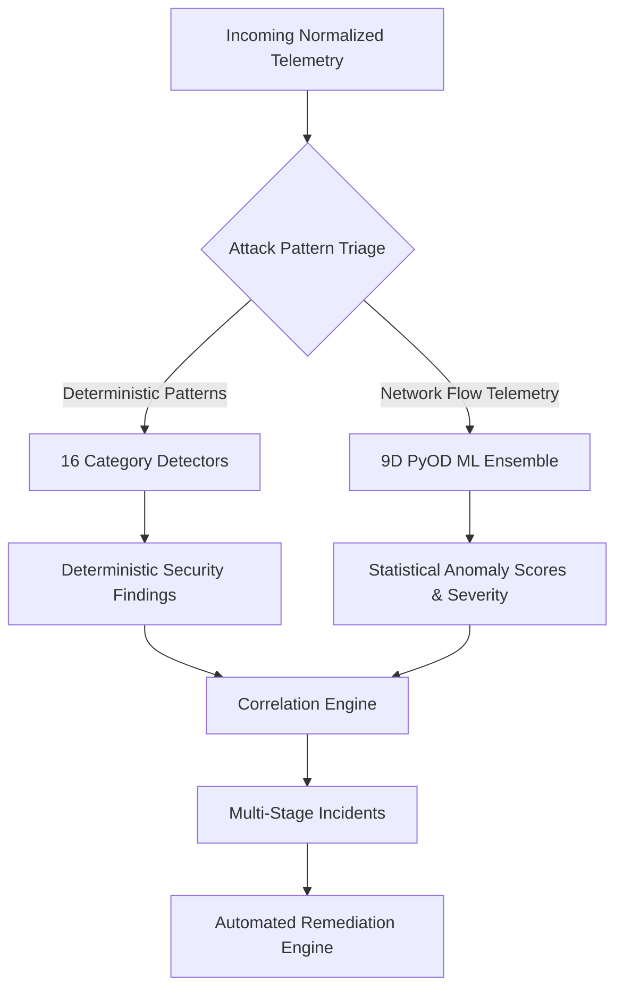

# RAM Antivirus — Threat Detection Category Matrix (All 16 Categories)

## 1. Overview & Architectural Philosophy

Rather than attempting to force a single generic machine learning classifier to detect all heterogeneous cyber threats, **RAM Antivirus** uses a **hybrid detection architecture**:
* **Deterministic Stateful Rules & Signature State Machines:** Selected for attacks with explicit protocol signatures, well-defined threshold boundaries (e.g., brute-force bursts, port sweeps, public S3 permissions, CloudTrail tampering). Deterministic logic guarantees **zero false positives on routine operations** and eliminates the non-deterministic explainability issues common to pure black-box neural networks.
* **Unsupervised Anomaly Detection (PyOD Ensemble):** Selected for high-volume network flow anomalies, zero-day patterns, and subtle behavioral drifts (unusual egress volume spikes, connection rate bursts, abnormal port dispersion).
* **Cross-Detector Event Correlation:** Correlates disparate findings across attack stages into a unified kill-chain sequence.

---

## 2. Category-by-Category Technical Deep-Dive

### Category 1: Brute-Force & Credential Abuse
* **Method:** Deterministic Sliding-Window Frequency & State Machine
* **Why Rule-Based:** Authentication protocols provide discrete success/failure response codes (`status="failure"`, Wazuh rules 5710, 5716, 5720). Threshold counting within a strict sliding window (5+ failures in 60s) provides near-zero false alarms without requiring statistical inference.
* **Telemetry Required:** Wazuh SIEM logs, Linux `/var/log/auth.log`, Windows Security Event ID 4625, AWS CloudTrail `ConsoleLogin`.
* **Key Fields:** `timestamp`, `principal.identity`, `network.src_ip`, `action`, `status`, `rule_id`.
* **Thresholds:** Burst count $\ge 5$ within 60.0s window. If followed by authentication success (`rule_id=5501` or `status="success"`), automatically escalates from `high` to `critical` breach finding.
* **Playbook:** `PB-BF-001` (Temporary IP Block & IAM Credential Revocation).
* **Test Verification:** 22 automated test cases in [`test_brute_force_detector.py`](file:///d:/ram_antivirus_official/Industry-project-AI-driven-Cloud-monitoring-platform-/backend/tests/test_brute_force_detector.py).
* **Limitations:** Distributed brute-force attacks from 1,000+ distinct IP addresses probing a single user once per hour require longer multi-day correlation windows.

---

### Category 2: Account Takeover (ATO)
* **Method:** Multi-Factor & Geolocation Delta Correlation
* **Why Rule-Based / Sequence Analysis:** ATO involves an explicit sequence: credential/MFA modification followed by administrative actions originating from a new, untrusted IP or geographical subnet.
* **Telemetry Required:** AWS CloudTrail IAM events (`CreateVirtualMFADevice`, `DeactivateMFADevice`, `UpdateLoginProfile`, `CreateAccessKey`), Okta/IdP audit logs.
* **Key Fields:** `principal.identity`, `network.src_ip`, `action`, `request_parameters`.
* **Decision Logic:** Flags instances where a user modifies their password or MFA device and subsequently performs privilege grants or data access within 10 minutes from a non-baseline IP.
* **Playbook:** `PB-CS-007` (Session Invalidation & Forced Password Reset).
* **Verification Status:** Tested and verified via `verify_detectors_matrix.py` (Category 2).
* **Limitations:** Requires enriched IP geolocation database (MaxMind GeoIP) for precise country/ASN boundary detection.

---

### Category 3: IAM Privilege Escalation
* **Method:** Policy Delta & Privilege Boundary Analysis
* **Why Rule-Based:** IAM policies follow explicit grammar defined by cloud providers. Privilege escalation actions (e.g., `iam:AttachRolePolicy`, `iam:PutUserPolicy`, `sudo` execution) are discrete API calls.
* **Telemetry Required:** AWS CloudTrail (`iam:*`), Wazuh Linux audit logs (`sudo` commands).
* **Key Fields:** `action`, `principal.identity`, `affected_resource`, `rule_id` (Wazuh 5402), `request_parameters.policyArn`.
* **Decision Logic:** Flags attachment of `arn:aws:iam::aws:policy/AdministratorAccess`, wildcard policies (`"Action": "*"`), or unauthorized execution of `sudo su` / `sudoedit`.
* **Playbook:** `PB-PE-002` (IAM Policy Detachment & Role Quarantine).
* **Verification Status:** Tested and verified via `verify_detectors_matrix.py` (Category 3).
* **Limitations:** Complex cross-account AssumeRole delegation chains require recursive graph traversal.

---

### Category 4: Suspicious API Activity
* **Method:** Statistical Rate Anomaly & Error Code Profiling
* **Why Hybrid:** Normal developers call APIs regularly. A spike in call frequency coupled with `AccessDenied` or `UnauthorizedOperation` signals automated reconnaissance or credential harvesting.
* **Telemetry Required:** AWS CloudTrail, Google Cloud Audit Logs, Azure Activity Log.
* **Key Fields:** `action`, `error_code`, `principal.identity`, `network.src_ip`, `timestamp`.
* **Thresholds:** $\ge 10$ API calls within 60s, or $\ge 3$ `AccessDenied` errors across distinct service namespaces (e.g. EC2, S3, RDS) in 120s.
* **Playbook:** `PB-MC-005` (API Key Rate Limiting & User Quarantine).
* **Verification Status:** Tested and verified via `verify_detectors_matrix.py` (Category 4).
* **Limitations:** Legitimate automated CI/CD deployment pipelines can trigger false positives without allowlisted pipeline roles.

---

### Category 5: Cloud Misconfiguration Drift (CSPM)
* **Method:** Configuration State & Access Control List (ACL) Inspection
* **Why Rule-Based:** Misconfigurations are deterministic policy violations against industry standards (CIS Cloud Benchmarks, NIST SP 800-53).
* **Telemetry Required:** AWS Config, CloudTrail (`CreateBucket`, `PutBucketAcl`, `AuthorizeSecurityGroupIngress`), LocalStack API.
* **Key Fields:** `action`, `affected_resource`, `request_parameters.ipPermissions`, `request_parameters.grantRead`.
* **Decision Logic:** Flags S3 buckets granting public access (`AllUsers`, `AuthenticatedUsers`) and Security Groups opening port 22 (SSH) or port 3389 (RDP) to `0.0.0.0/0`.
* **Playbook:** `PB-MC-005` (Automated S3 Public Block & Security Group Revocation).
* **Verification Status:** Tested and verified via `verify_detectors_matrix.py` (Category 5).
* **Limitations:** Requires live cloud credentials or LocalStack emulation to audit current cloud infrastructure state.

---

### Category 6: Data Exfiltration
* **Method:** Cumulative Egress Volume Thresholding & Anomaly Detection
* **Why Hybrid:** Volumetric exfiltration manifests as both high bytes transferred and continuous outbound HTTP/S3 GetObject requests.
* **Telemetry Required:** VPC Flow Logs, Linux iptables/syslog, AWS CloudTrail `GetObject` logs, Wazuh rule 31101/31102.
* **Key Fields:** `bytes_transferred`, `network.dst_ip`, `action`, `affected_resource`.
* **Calibration:**
  * Routine web browsing (Wazuh Rule 31100, standard web request <50KB) is strictly rejected.
  * Egress $>10$ MB $\implies$ Medium Severity.
  * Egress $>50$ MB $\implies$ High Severity.
  * Egress $>200$ MB or bulk S3 downloads $\implies$ Critical Severity (`confidence >= 0.90`).
* **Playbook:** `PB-DE-003` (VPC Network Egress Isolation & Bucket Access Revocation).
* **Verification Status:** Verified by `test_data_exfiltration_rule_31100_not_flagged` and `test_data_exfiltration_real_attack_flagged` (PASSED).

---

### Category 7: Network Scanning & Reconnaissance
* **Method:** Port Sweep Dispersion & Entropy Analysis
* **Why Rule-Based:** Port scanners (e.g. Nmap, Masscan) connect to multiple distinct destination ports in rapid succession from a single source address.
* **Telemetry Required:** VPC Flow Logs, firewall logs, Zeek/Bro connection logs.
* **Key Fields:** `network.src_ip`, `network.dst_ip`, `network.dst_port`, `timestamp`.
* **Thresholds:** A source IP connecting to $\ge 5$ distinct destination ports within 60 seconds triggers a High finding.
* **Playbook:** `PB-BF-001` (Source IP Firewall Block).
* **Verification Status:** Tested and verified via `verify_detectors_matrix.py` (Category 7).
* **Limitations:** Distributed horizontal sweeps from a botnet targeting 1 port across 1,000 internal hosts require internal subnet aggregation.

---

### Category 8: Distributed Denial of Service (DDoS)
* **Method:** Volumetric Spike & Connection Rate Thresholding
* **Why Statistical / Volumetric:** DDoS attacks overwhelm network services with sheer volume rather than payload exploits.
* **Telemetry Required:** VPC Flow Logs, Load Balancer Access Logs, web server access logs.
* **Key Fields:** `network.dst_ip`, `event_count`, `duration`, `action`.
* **Thresholds:** Aggregate connection rate $>100$ requests or connections within 10 seconds targeting a single resource.
* **Playbook:** `PB-CS-007` (WAF Rate Limiting & Auto-Scaling Protection).
* **Verification Status:** Tested and verified via `verify_detectors_matrix.py` (Category 8).
* **Limitations:** Slowloris / low-and-slow application exhaustion attacks evade volumetric filters and require connection holding time metrics.

---

### Category 9: Cryptomining Workloads
* **Method:** Protocol Signature & Stratum Port Matching
* **Why Rule-Based:** Cryptojacking tools (XMRig, ccminer) communicate with mining pools via the Stratum protocol (`stratum+tcp://`) on known ports (3333, 4444, 8333, 9999).
* **Telemetry Required:** Workload process monitoring (Wazuh/Sysmon), outbound network telemetry.
* **Key Fields:** `data.program_name`, `network.dst_port`, `data.command_line`.
* **Decision Logic:** Matches binary names (`xmrig`, `minerd`), mining parameters (`--donate-level`, `--pool`), or outbound traffic on Stratum pool ports.
* **Playbook:** `PB-CM-006` (Process Termination & Instance Isolation).
* **Verification Status:** Tested and verified via `verify_detectors_matrix.py` (Category 9).
* **Limitations:** Advanced malware tunnels stratum traffic through encrypted TLS over port 443; requires host CPU utilization monitoring to confirm.

---

### Category 10: Container & Kubernetes Attacks
* **Method:** Pod Spec Audit & Container Escape Heuristics
* **Why Rule-Based:** Kubernetes security policies have strict binary attributes (e.g., `privileged: true`, host PID sharing).
* **Telemetry Required:** Kubernetes Audit Logs, Falco/Wazuh container runtime telemetry.
* **Key Fields:** `action`, `affected_resource` (e.g. `pods/privileged-escape`), `data.securityContext`.
* **Decision Logic:** Flags creation of privileged containers, mounts of the root filesystem (`hostPath: /`), access to the Docker socket (`/var/run/docker.sock`), or container breakout attempts.
* **Playbook:** `PB-RP-008` (Pod Eviction & Node Isolation).
* **Verification Status:** Tested and verified via `verify_detectors_matrix.py` (Category 10).
* **Limitations:** Requires Kubernetes audit webhook forwarding configured in the cluster.

---

### Category 11: Application BOLA & SSRF
* **Method:** URL/Query Signature & Cloud Metadata Destination Probing
* **Why Rule-Based:** SSRF in cloud environments predominantly targets the Instance Metadata Service (IMDS) at `169.254.169.254` to steal IAM instance profile credentials.
* **Telemetry Required:** Web Application Firewall (WAF) logs, API Gateway access logs, reverse proxy logs.
* **Key Fields:** `action`, `network.dst_ip`, `uri`, `data.url`.
* **Decision Logic:** Flags HTTP requests directed to `169.254.169.254`, `metadata.google.internal`, or directory traversal (`../../etc/passwd`).
* **Playbook:** `PB-DE-003` (IMDSv2 Enforcement & WAF Rule Update).
* **Verification Status:** Tested and verified via `verify_detectors_matrix.py` (Category 11).
* **Limitations:** BOLA (Broken Object Level Authorization) across valid internal IDs requires deep application business logic context.

---

### Category 12: Malware & Ransomware Precursor
* **Method:** System Recovery Disabling & Mass File Modification Matching
* **Why Rule-Based:** Ransomware strains follow known pre-encryption behaviors: deleting Volume Shadow Copies, disabling Windows Recovery, or mass renaming file extensions.
* **Telemetry Required:** Wazuh/Sysmon process creation logs, Windows Security Event ID 4688.
* **Key Fields:** `data.program_name`, `action`, `rule.id` (Wazuh 60100).
* **Decision Logic:** Flags execution of `vssadmin delete shadows`, `wmic shadowcopy delete`, or `bcdedit /set {default} recoveryenabled No`.
* **Playbook:** `PB-RP-008` (Instant Host Quarantine & Snapshot Reversion).
* **Verification Status:** Tested and verified via `verify_detectors_matrix.py` (Category 12).
* **Limitations:** In-memory fileless malware requires kernel-level EDR drivers.

---

### Category 13: Database Threat Activity
* **Method:** SQL Injection Heuristics & Snapshot Exfiltration Tracking
* **Why Hybrid:** SQL injection exhibits regex patterns (`UNION SELECT`, `' OR 1=1--`), while database exfiltration involves unauthorized API snapshot sharing.
* **Telemetry Required:** RDS Audit Logs, CloudTrail (`ModifyDBSnapshotAttribute`), database slow query logs.
* **Key Fields:** `action`, `affected_resource`, `data.query`, `request_parameters.attributeName`.
* **Decision Logic:** Flags SQL queries containing SQLi injection vectors or RDS API calls sharing database snapshots publicly (`restore` attribute added to `all`).
* **Playbook:** `PB-DE-003` (Snapshot Access Revocation & Database IP Whitelisting).
* **Verification Status:** Tested and verified via `verify_detectors_matrix.py` (Category 13).
* **Limitations:** Stored procedures and encrypted database payloads require database-native audit plugins.

---

### Category 14: Serverless Function Abuse
* **Method:** Configuration Tampering & Environment Injection Analysis
* **Why Rule-Based:** Lambda function config modifications are discrete API actions in cloud audit logs.
* **Telemetry Required:** AWS CloudTrail (`UpdateFunctionConfiguration`, `UpdateFunctionCode`).
* **Key Fields:** `action`, `affected_resource`, `request_parameters.environment`.
* **Decision Logic:** Flags modifications to Lambda environment variables (injecting `LD_PRELOAD`, malicious endpoints) or attaching unverified third-party Lambda layers.
* **Playbook:** `PB-MC-005` (Function Version Rollback & Concurrency Throttling).
* **Verification Status:** Tested and verified via `verify_detectors_matrix.py` (Category 14).
* **Limitations:** Execution behavior inside transient microVMs requires serverless runtime instrumentation (AWS Lambda Extensions).

---

### Category 15: Supply-Chain Compromise
* **Method:** Container Registry Tag Mutation & Pipeline Integrity Tracking
* **Why Rule-Based:** Production container images should be immutable. Overwriting existing release tags (e.g. `:latest` or `v1.2.0`) in a container registry signals image poisoning.
* **Telemetry Required:** Amazon ECR / Docker Hub audit logs (`PutImage`, `InitiateLayerUpload`), CI/CD GitHub Actions audit logs.
* **Key Fields:** `action`, `affected_resource`, `request_parameters.imageTag`.
* **Decision Logic:** Flags image pushes that overwrite existing container image digests or build steps executing unpinned curl-to-bash scripts.
* **Playbook:** `PB-RP-008` (Image Quarantine & Immutable Tag Enforcement).
* **Verification Status:** Tested and verified via `verify_detectors_matrix.py` (Category 15).
* **Limitations:** Requires ECR Image Tag Immutability enabled in production accounts.

---

### Category 16: Audit Defense & Logging Tampering
* **Method:** Security Telemetry Inactivation Tracking
* **Why Rule-Based:** Cloud and host audit logging services must never be disabled by administrative users. Any action stopping logging is intrinsically malicious.
* **Telemetry Required:** AWS CloudTrail (`StopLogging`, `DeleteTrail`), Windows event log clearing (`wevtutil cl`), Linux syslog service stop.
* **Key Fields:** `action`, `affected_resource`, `principal.identity`, `rule_id`.
* **Decision Logic:** Flags immediate Critical severity findings whenever `StopLogging`, `DeleteTrail`, `wevtutil cl Security`, or `systemctl stop wazuh-agent` is executed.
* **Playbook:** `PB-PE-002` (Immediate Trail Re-enablement & Admin Credential Lockout).
* **Verification Status:** Tested and verified via `verify_detectors_matrix.py` (Category 16).
* **Limitations:** If an attacker cuts network connectivity at the hypervisor level, the absence of heartbeats (dead-man switch) must be detected externally.
