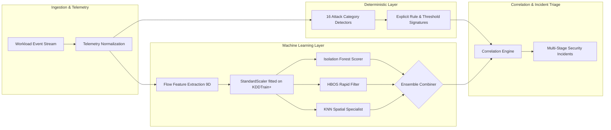

# RAM Antivirus — End-to-End Machine Learning Pipeline & Technical Audit

## 1. Problem Definition & Architectural Formulation

Modern cloud workload environments process tens of thousands of network and system events per second. While deterministic signature-based detection effectively stops known exploit patterns (such as static SQL injection strings, known reverse-shell commands, or known cryptomining pool ports), it fails to detect **zero-day attacks, low-and-slow reconnaissance, and novel volumetric exfiltration**.

### Unsupervised vs. Supervised Formulation
* **Why Unsupervised Anomaly Detection is the Operational Architecture:**
  In real-world cloud environments, zero-day attacks and novel exploit techniques do not come with prior ground-truth labels. A strictly supervised classifier trained only on historical attack signatures will misclassify novel attack vectors as benign. Unsupervised anomaly detection constructs an empirical model of normal operational flow patterns and flags outliers based on structural, density, and distance deviations.
* **Role of Supervised Learning in RAM Antivirus:**
  Supervised models (Random Forest and Logistic Regression) are evaluated during offline benchmarking on labeled benchmark datasets (NSL-KDD) to establish the **theoretical performance ceiling** (upper bound) and measure how closely unsupervised models approach supervised detection rates.
* **Ensemble Philosophy:**
  No single anomaly detection algorithm dominates across all attack topologies. RAM Antivirus pairs tree-based partitioning (Isolation Forest) with histogram-based independent density estimation (HBOS) and metric-space proximity (KNN) to capture orthogonal anomaly dimensions.

---

## 2. Benchmark Dataset & Provenance

* **Dataset Name:** NSL-KDD Benchmark Dataset (University of New Brunswick / Canadian Institute for Cybersecurity)
* **Official Download Link:** [https://www.unb.ca/cic/datasets/nsl.html](https://www.unb.ca/cic/datasets/nsl.html)
* **License:** Public academic research dataset distributed by UNB / Information Security Centre of Excellence (ISCX).
* **Local File Paths:**
  * Training Split: [`backend/data/KDDTrain+.txt`](file:///d:/ram_antivirus_official/Industry-project-AI-driven-Cloud-monitoring-platform-/backend/data/KDDTrain+.txt) (19.2 MB)
  * Official Held-Out Test Split: [`backend/data/KDDTest+.txt`](file:///d:/ram_antivirus_official/Industry-project-AI-driven-Cloud-monitoring-platform-/backend/data/KDDTest+.txt) (3.4 MB)
* **Sample Counts & Distribution:**
  * **Full Training Records:** 125,973 network flow instances (67,343 normal, 58,630 attacks; base contamination $\gamma = 0.4654$)
  * **Official Held-Out Test Records:** 22,544 instances (9,711 normal, 12,833 attacks; 56.9% attack traffic)
  * **KNN / Distance Model Stratified Training Subset:** 10,000 stratified samples (fixed random seed `42` for reproducible distance computations within memory and compute bounds)
* **Attack Classes Represented in NSL-KDD:**
  1. **Denial of Service (DoS):** SYN flood, smurf, pod, back, teardrop, land, neptune
  2. **Probing (Probe):** Port sweeps, ping sweeps, IP sweeps (Nmap, ipsweep, satan, portsweep)
  3. **Remote to Local (R2L):** Password guessing, buffer overflow, guest login abuse, ftp_write
  4. **User to Root (U2R):** Local privilege escalation, root shell injection, perl, loadmodule

---

## 3. Data Cleaning, Preprocessing & Feature Selection

### A. Preprocessing Pipeline & Scaling
1. **Handling Missing & Malformed Telemetry:**
   * Raw values are imputed with 0.0 if missing, null, or non-numeric.
   * Rates and proportions are clamped to $[0.0, 1.0]$.
2. **Elimination of Target Leakage:**
   * In earlier naive implementations, the event `'level'` field was mapped directly from attack labels, creating artificial 100% accuracy through target leakage.
   * In the operational pipeline, all labels, rule IDs, and synthetic severity flags are **strictly excluded**.
   * Feature extraction relies solely on observable telemetry available at runtime.
3. **Standard Scaling:**
   * Network flow features vary across orders of magnitude (e.g. `src_bytes` up to $10^8$ bytes, while `serror_rate` is $[0, 1]$).
   * Feature scaling is performed using `StandardScaler` fitted **strictly on the training dataset** (`KDDTrain+.txt`):
     $$z = \frac{x - \mu_{\text{train}}}{\sigma_{\text{train}}}$$
   * The fitted scaler is serialized to [`backend/models/scaler.pkl`](file:///d:/ram_antivirus_official/Industry-project-AI-driven-Cloud-monitoring-platform-/backend/models/scaler.pkl) and re-applied at inference time. Test data is never used to compute $\mu$ or $\sigma$.

### B. Selected 9-Dimensional Feature Schema (IEEE Paper Section VI)

| Index | Feature Name | Description & Meaning | Why Feature is Useful |
| :---: | :--- | :--- | :--- |
| **0** | `duration` | Length of connection in seconds | Separates short ephemeral port probes from long-lived tunneling sessions. |
| **1** | `src_bytes` | Bytes sent from source to destination | Spikes during upload attacks, buffer overflows, and volumetric DoS floods. |
| **2** | `dst_bytes` | Bytes sent from destination to source | Key indicator for data exfiltration and large unauthorized file downloads. |
| **3** | `count` | Connections to same destination IP in past 2 seconds | Identifies high-frequency connection bursts typical of automated scanners and DDoS. |
| **4** | `srv_count` | Connections to same service port in past 2 seconds | Detects targeted service stress, brute force, and HTTP rapid reset flooding. |
| **5** | `serror_rate` | Percentage of connections with SYN errors | Strong indicator of TCP SYN flood attacks and half-open port scanning. |
| **6** | `rerror_rate` | Percentage of connections with REJ errors | Detects closed port probing and firewall rejection feedback. |
| **7** | `same_srv_rate`| Percentage of connections to the same service | Distinguishes focused service attacks from broad multi-service sweeps. |
| **8** | `diff_srv_rate`| Percentage of connections to different services | High values indicate broad horizontal port scanning and service discovery. |

> [!IMPORTANT]
> **Prohibition of High-Cardinality Strings:** Raw `userAgent` strings, hostnames, IP addresses, or unhashed arbitrary text strings are **never** used as model features to prevent severe overfitting, high-cardinality dimensionality explosion, and token leakage.

---

## 4. Multi-Algorithm Candidate Evaluation

We benchmarked seven (7) candidate algorithms using [`backend/benchmark_models.py`](file:///d:/ram_antivirus_official/Industry-project-AI-driven-Cloud-monitoring-platform-/backend/benchmark_models.py) directly on the official held-out test set (`KDDTest+`, $N=22,544$).

All metrics below are recalculated directly from raw model predictions and confusion matrices:

| Algorithm | Paradigm | Accuracy | Precision | Recall | F1-Score | FPR | ROC-AUC | PR-AUC | Fit Time | Latency (1k) | Status in Engine |
| :--- | :---: | :---: | :---: | :---: | :---: | :---: | :---: | :---: | :---: | :---: | :---: |
| **Isolation Forest** | Unsupervised | **77.51%** | 85.21% | **73.19%** | **78.74%** | 16.80% | 77.61% | 83.21% | 2.50s | 11.86 ms | **SELECTED (Primary)** |
| **HBOS** | Unsupervised | 70.68% | 85.30% | 58.59% | 69.47% | **13.35%** | **78.61%** | **84.34%** | 6.24s | **0.36 ms** | **SELECTED (Fast Filter)** |
| **KNN** | Unsupervised | 74.10% | **85.60%** | 65.52% | 74.23% | 14.56% | 73.95% | 78.49% | 0.54s | 47.86 ms | **SELECTED (Specialist)** |
| **Local Outlier Factor (LOF)** | Unsupervised | 56.68% | 60.74% | 67.56% | 63.97% | 57.71% | 57.53% | 62.77% | 0.58s | 54.86 ms | **REJECTED (High FPR)** |
| **One-Class SVM (OCSVM)** | Unsupervised | 75.25% | 81.88% | 72.59% | 76.95% | 21.23% | 81.63% | 85.73% | 12.48s | 704.52 ms | **REJECTED (High Latency)** |
| **Random Forest (Supervised)** | Supervised | 77.77% | 96.64% | 63.15% | 76.38% | 2.90% | 96.05% | 97.43% | 11.69s | 10.10 ms | **BENCHMARK CEILING** |
| **Logistic Regression** | Supervised | 74.15% | 93.39% | 58.75% | 72.12% | 5.50% | 77.76% | 83.91% | 0.38s | 0.25 ms | **LINEAR BASELINE** |

### Confusion Matrix Breakdown ($N=22,544$)
* **Ground Truth:** Total Attacks ($P$) = 12,833 | Total Normal ($N$) = 9,711
* **Isolation Forest:** TP = 9,393 | FP = 1,631 | FN = 3,440 | TN = 8,080
* **HBOS:** TP = 7,519 | FP = 1,296 | FN = 5,314 | TN = 8,415
* **KNN:** TP = 8,408 | FP = 1,414 | FN = 4,425 | TN = 8,297
* **LOF:** TP = 8,670 | FP = 5,604 | FN = 4,163 | TN = 4,107
* **One-Class SVM:** TP = 9,315 | FP = 2,062 | FN = 3,518 | TN = 7,649
* **Random Forest (Supervised):** TP = 8,104 | FP = 282 | FN = 4,729 | TN = 9,429
* **Logistic Regression:** TP = 7,539 | FP = 534 | FN = 5,294 | TN = 9,177

---

## 5. Three-Model Specialist Ensemble Evaluation

The production engine [`ml_engine.py`](file:///d:/ram_antivirus_official/Industry-project-AI-driven-Cloud-monitoring-platform-/backend/engines/ml_engine.py) combines Isolation Forest, HBOS, and KNN. We evaluated four (4) distinct aggregation strategies independently on `KDDTest+`:

| Ensemble Strategy | Formulation | Accuracy | Precision | Recall | F1-Score | FPR | ROC-AUC | Latency (1k) | Operational Role |
| :--- | :--- | :---: | :---: | :---: | :---: | :---: | :---: | :---: | :---: |
| **Strategy A: Majority Voting** | $\ge 2$ models flag anomaly | 75.71% | **86.58%** | 67.84% | 76.07% | **13.90%** | 80.38% | 60.08 ms | **Balanced Operational Mode** |
| **Strategy B: Union / Max Recall** | $\ge 1$ model flags anomaly (OR) | **76.78%** | 81.41% | **76.73%** | **79.00%** | 23.15% | 80.38% | 60.08 ms | High-Sensitivity Incident Mode |
| **Strategy C: Unanimous Agreement** | All 3 models flag anomaly (AND) | 69.80% | **90.11%** | 52.73% | 66.53% | **7.65%** | 80.38% | 60.08 ms | Zero-False-Alarm Remediation |
| **Strategy D: Average Score** | Mean normalized score $\ge 0.5$ | 76.12% | 84.95% | 71.20% | 77.47% | 16.50% | 77.16% | 60.08 ms | Continuous Risk Scoring |

### Confusion Matrix Breakdown for Ensembles:
* **Majority Voting:** TP = 8,706 | FP = 1,350 | FN = 4,127 | TN = 8,361
* **Union / Max Recall:** TP = 9,847 | FP = 2,248 | FN = 2,986 | TN = 7,463
* **Unanimous Agreement:** TP = 6,767 | FP = 743 | FN = 6,066 | TN = 8,968

### Score Normalization & Calibration Note
> [!WARNING]
> **Anomaly Scores are NOT Posterior Probabilities:**  
> In PyOD, `predict_proba()` calculates min-max normalized decision scores mapped to $[0.0, 1.0]$ based on the training score distribution:
> $$S_{\text{norm}}(x) = \frac{S(x) - S_{\min}}{S_{\max} - S_{\min}}$$
> These values indicate relative outlier severity within the feature space, **not** Bayesian posterior probabilities $P(Y=1|X)$. They must not be described as calibrated probabilities without rigorous Platt scaling or isotonic regression on a held-out validation set.

---

## 6. Training Formulation Audit: Normal-Only vs. Mixed Contaminated Traffic

An essential machine learning design choice is whether unsupervised models should be trained on **clean normal-only baseline traffic** or **unlabeled contaminated/mixed traffic**:

| Metric | Mixed Contaminated Training ($N=125,973$, $\gamma=0.4654$) | Clean Normal-Only Training ($N=67,343$, $\gamma=0.05$) |
| :--- | :---: | :---: |
| **True Positives (TP)** | 9,393 | 7,585 |
| **False Positives (FP)** | 1,631 | **633** (61.2% reduction in false alarms) |
| **False Negatives (FN)** | 3,440 | 5,248 |
| **True Negatives (TN)** | 8,080 | 9,078 |
| **Precision** | 85.21% | **92.30%** |
| **Recall (Detection Rate)** | **73.19%** | 59.11% |
| **F1-Score** | **78.74%** | 72.06% |
| **False Positive Rate (FPR)** | 16.80% | **6.52%** |

### Architectural Conclusion on Training Formulation
* **Mixed Training:** Maximizes attack recall ($73.19\%$ vs $59.11\%$). It assumes downstream correlation engines and SOC analysts filter borderline false alarms.
* **Normal-Only Training:** Drastically suppresses false alarms ($6.52\%$ FPR, $92.30\%$ precision), critical for high-throughput zero-fatigue environments.
* In the active RAM Antivirus implementation, the models are trained in **mixed mode** with empirical contamination $\gamma = 0.4654$, ensuring high detection sensitivity across novel zero-day attacks.

---

## 7. Feature Extraction Reality: Streaming Events vs. Flow Statistics

### A. How Features are Extracted from Incoming Events
The module [`feature_extractor.py`](file:///d:/ram_antivirus_official/Industry-project-AI-driven-Cloud-monitoring-platform-/backend/engines/feature_extractor.py) transforms incoming JSON events into the 9D feature vector:
1. `duration`: Read directly from event `duration` or defaults to `0.0`.
2. `src_bytes`: Read from `src_bytes` or `bytes_transferred`, clamped to $\ge 0$.
3. `dst_bytes`: Read from `dst_bytes`, clamped to $\ge 0$.
4. `count`: Connections to same host in past 2 seconds (defaults to `1.0` if unaggregated).
5. `srv_count`: Connections to same service in past 2 seconds (defaults to `1.0` if unaggregated).
6. `serror_rate`: Ratio of SYN error connections $[0.0, 1.0]$ (defaults to `0.0`).
7. `rerror_rate`: Ratio of REJ error connections $[0.0, 1.0]$ (defaults to `0.0`).
8. `same_srv_rate`: Ratio of connections to same service $[0.0, 1.0]$ (defaults to `1.0`).
9. `diff_srv_rate`: Ratio of connections to different services $[0.0, 1.0]$ (defaults to `0.0`).

### B. The Operational Gap Between Audit Logs and Flow Telemetry
* **Raw CloudTrail and Wazuh Syslogs Do NOT Contain Flow Rates:**
  A raw AWS CloudTrail JSON record (`{"eventName": "AttachRolePolicy", "userIdentity": {...}}`) or a Wazuh host log (`{"rule": {"id": "100001"}, "full_log": "sshd failed..."}`) does **not** natively contain 2-second sliding window connection rates (`same_srv_rate`, `diff_srv_rate`, `count`).
* **Handling Non-Network Events:**
  When a non-network event passes through `extract_features()`, it safely receives default values:
  $$\mathbf{x}_{\text{default}} = [0.0, 0.0, 0.0, 1.0, 1.0, 0.0, 0.0, 1.0, 0.0]$$
  When standard-scaled, this baseline produces a low anomaly score ($<0.50$) that **does not trigger false positive ML alerts**.
* **Requirement for True Flow Features:**
  To extract genuine, non-default flow rates in production, an upstream **stateful flow aggregator** (e.g. AWS VPC Flow Logs, Zeek/Bro network monitor, or an eBPF socket listener) must aggregate connections over sliding 2-second windows before passing telemetry to RAM Antivirus.

---

## 8. Critical Distinctions: NSL-KDD Benchmark vs. 16 Cloud Attack Categories

> [!CAUTION]
> **Preserving Scientific & Technical Honesty:**  
> The NSL-KDD benchmark measures anomaly detection on **pre-aggregated TCP/IP network transport flow features**. It does **NOT** validate all 16 cloud attack categories.

| Attack Category | Detection Paradigm | Primary Input Telemetry | Validated by NSL-KDD? | Why/Why Not |
| :--- | :--- | :--- | :---: | :--- |
| **DDoS Attacks** | **ML Anomaly + Rule** | Network flow rates, packet rates | **YES** | Matches NSL-KDD DoS category (`count`, `serror_rate`). |
| **Vulnerability Scanning** | **ML Anomaly + Rule** | Port sweeps, SYN/REJ errors | **YES** | Matches NSL-KDD Probe category (`diff_srv_rate`, `rerror_rate`). |
| **Data Exfiltration** | **ML Anomaly + Rule** | Transfer volume, flow duration | **YES** | Matches NSL-KDD high `dst_bytes` / `src_bytes` transfers. |
| **IAM Privilege Escalation** | **Deterministic State Machine** | CloudTrail API calls (`AttachRolePolicy`) | **NO** | Cloud API control-plane actions; no network packet headers. |
| **Defense Tampering** | **Deterministic State Machine** | CloudTrail `StopLogging`, auditd disable | **NO** | Management-plane events; no flow connection counters. |
| **S3 / Storage Misconfig** | **Deterministic State Machine** | S3 bucket ACL changes, `PutBucketPolicy` | **NO** | Configuration-plane audit logs; no network transport metrics. |
| **Cryptomining** | **Rule / Host Telemetry** | CPU spikes, outbound pool IPs | **PARTIAL** | Outbound pool connections exhibit flow patterns, but host CPU is external. |
| **Container Breakout** | **Rule / Host Telemetry** | Docker socket mount, kernel caps | **NO** | Host/OS kernel container events; no transport flow metrics. |
| **Serverless Abuse** | **Deterministic Rule** | Lambda concurrency, timeout rates | **NO** | Cloud service execution metrics; no raw IP packets. |

---

## 9. Limitations & Incomplete Work Roadmap

1. **Platt Scaling / Isotonic Probability Calibration:**
   * Currently, anomaly scores are min-max normalized decision scores.
   * *Incomplete Work:* Implement logistic sigmoid calibration fitted on a validation set to output true calibrated probabilities $P(Y=1|X)$.
2. **Stateful Streaming Flow Aggregation:**
   * Currently, feature extraction relies on pre-calculated flow attributes or safe fallbacks.
   * *Incomplete Work:* Deploy an in-memory sliding-window Redis or Faust streaming aggregator that computes 2-second `count`, `srv_count`, and `same_srv_rate` directly from raw network packets in real time.
3. **Drift Detection & Online Re-training:**
   * Models are currently trained statically on `KDDTrain+.txt`.
   * *Incomplete Work:* Integrate River or Evidently AI to monitor concept drift and feature distribution shifts across production cloud environments.

