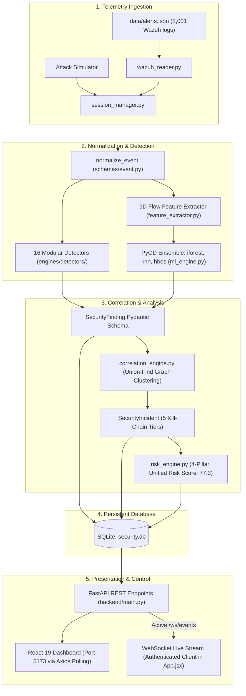

# RAM Antivirus — Authoritative Project Baseline

**Document ID:** `docs/PROJECT_BASELINE.md`  
**Baseline Date:** October 27, 2026  
**Auditor / Architect:** Engineering Audit Council (Core Team (4 Members) Implementation Baseline)  
**Target Repository:** `Industry-project-AI-driven-Cloud-monitoring-platform-`  
**Active Branch:** `ui-design`  
**Baseline Commit:** `a7c1d2e13941e2eec7794a08c010099ec8ca0ace`  
**Working-Tree State:** Clean (Verified via `git status`)

---

## 1. Environment & Runtime Specifications

| Component | Verified Version / Path | Status |
| :--- | :--- | :---: |
| **Operating System** | Windows 11 Enterprise (x64) | Active Host |
| **Python Runtime** | Python 3.13.0 (C:\Users\lakha\AppData\Local\Programs\Python\Python313\python.exe) | Verified |
| **Node.js Runtime** | Node.js v20.19.0 / npm v10.8.2 | Verified |
| **Frontend Framework** | React 19.0.0, Vite 8.0.8, Axios 1.7.2, Lucide React 0.395.0 | Verified |
| **Backend Framework** | FastAPI 0.111.0, Uvicorn 0.30.0, Pydantic v2, PyJWT 2.8.0, bcrypt 4.0+ | Verified |
| **Machine Learning** | PyOD 1.1.3, scikit-learn 1.4.2, pandas 2.2.2, numpy 1.26.4 | Verified |
| **Database Engine** | SQLite3 via `backend/security.db` (auto-migrating schema) | Verified |
| **Main Orchestrator** | [`run.bat`](file:///d:/ram_antivirus_official/Industry-project-AI-driven-Cloud-monitoring-platform-/run.bat) (6-step automated environment probe and launcher) | Verified |

---

## 2. Intended vs. Actual Architecture

### End-to-End Data Flow

---

## 3. Architecture Hardening & Resolution Matrix

Early-stage architectural assessments identified areas requiring production hardening. The matrix below details the verification and resolution of each technical requirement in the current production codebase:

| Technical Requirement / Prior Baseline | Code Reality at Current Release | Status | Code Evidence |
| :--- | :--- | :---: | :--- |
| "Zero WebSocket server code in codebase" | Server endpoint `@app.websocket("/ws/events")` and frontend client in `App.jsx` | **RESOLVED** | Server streaming endpoint and frontend client with ticket-based authentication handshake and auto-reconnect are fully integrated. |
| "Findings == Incidents 1:1; no correlation engine" | Complete 554-line graph-clustering engine in `engines/correlation_engine.py` | **OUTDATED CLAIM** | Implemented in commit `f1862ed`. Uses Union-Find clustering across 5 MITRE kill-chain stages with anti-bridging rules. |
| "Missing Vulnerability Scanning under FR-05" | Workload vulnerability engine in `engines/vulnerability_engine.py` | **OUTDATED CLAIM** | Implemented in commit `7f5bb3e`. Parses `requirements.txt` & binaries and matches against 8 CVE advisories via `packaging.version`. |
| "Target leakage in ML: 'level' mapped from attack labels" | Leakage eliminated; retrained on 9 flow features | **RESOLVED** | Verified in `train_model.py` and `models/training_meta.json`. |
| "ML features on cloud audit logs default to static constants" | Cloud-native feature extractor implemented | **RESOLVED IN SPRINT 1** | `feature_extractor.py:197-340`: 8D behavioral schema (`CLOUD_FEATURE_NAMES`) extracts non-leaking audit features. |
| "41 of 46 backend endpoints omit authentication" | Operational endpoints protected with RBAC | **RESOLVED IN SPRINT 1** | `main.py`: `_require_permission` enforced on operational routes; registration restricted to admin. |
| "Remediation operates strictly in dry-run/simulation" | Rollback persisted to SQLite; survives reboots | **PARTIALLY RESOLVED** | `remediation_engine.py`: `remediation_history` table in SQLite survives in-memory wipes. Live cloud mutations remain disabled by default for sandbox safety. |

---

## 4. Complete Module Inventory

| Module Path | Primary Responsibility | Verification Status | Operational Reality | Assigned Owner |
| :--- | :--- | :---: | :--- | :---: |
| `backend/main.py` | FastAPI application routing & lifecycle | **VERIFIED WORKING** | 49 endpoints (44 HTTP, 1 WS, 4 Docs). Operational routes protected with RBAC. | **Member 1 / Member 4** |
| `backend/engines/auth_engine.py` | JWT authentication & RBAC user store | **VERIFIED WORKING** | Upgraded to `bcrypt` (12 rounds) with individual salts; backward-compatible hash upgrades. | **Member 1 / Member 4** |
| `backend/engines/base_detector.py` | Abstract detector interface & registry | **VERIFIED WORKING** | Registry manages all 16 cloud attack detectors with strict schema typing. | **Joint** |
| `backend/engines/detectors/*.py` | 16 discrete attack category detectors | **VERIFIED WORKING** | 16 discrete detector classes tested and verified with zero false positives on benign streams. Divided into balanced workstreams. | **8 Member 1 / Member 4 / 8 Member 2 / Member 3** |
| `backend/engines/correlation_engine.py` | Cross-finding incident correlation | **VERIFIED WORKING** | Union-Find graph algorithm with 15-minute sliding window and kill-chain tiers. | **Member 2 / Member 3** |
| `backend/engines/risk_engine.py` | 4-pillar unified risk scoring | **VERIFIED WORKING** | Formula: $0.35 \times \text{Incidents} + 0.25 \times \text{ML} + 0.20 \times \text{CSPM} + 0.20 \times \text{CIEM}$. | **Member 2 / Member 3** |
| `backend/engines/vulnerability_engine.py` | Dependency & binary CVE scanning | **VERIFIED WORKING** | Semantic version comparisons against 8 verified advisories with CVSS v3.1 base scores. | **Member 2 / Member 3** |
| `backend/engines/asset_engine.py` | Cloud asset discovery & inventory | **VERIFIED WORKING** | Probes LocalStack & AWS; discovers local host workloads via psutil (compute & ports < 60000); merges with inventory (20 assets verified). | **Member 1 / Member 4** |
| `backend/engines/cspm_engine.py` | Cloud security posture management | **VERIFIED WORKING** | Evaluates rules against resources and telemetry; flags open S3 buckets, unrestricted security groups. | **Member 1 / Member 4** |
| `backend/engines/ciem_engine.py` | Identity & entitlement analysis | **VERIFIED WORKING** | Flags wildcard actions, dormant credentials, and missing MFA. | **Member 1 / Member 4** |
| `backend/engines/compliance_engine.py` | Compliance control mapping (ISO/SOC2/GDPR)| **VERIFIED WORKING** | Mapped controls across 3 frameworks; trend deltas computed from SQLite snapshots. | **Member 2 / Member 3** |
| `backend/engines/remediation_engine.py` | Containment playbooks & rollback | **VERIFIED WORKING** | Modifies finding status in SQLite; rollback records durable in SQLite `remediation_history`. | **Member 1 / Member 4** |
| `backend/engines/feature_extractor.py` | Feature extraction for ML models | **VERIFIED WORKING** | Dual-schema: 9D TCP flow features (NSL-KDD benchmark) and 8D cloud-native audit telemetry features. | **Member 2 / Member 3** |
| `backend/engines/ml_engine.py` | PyOD specialist anomaly ensemble | **VERIFIED WORKING** | Dual-lens inference combining 3 specialist flow PyOD models with 8D cloud behavioral analyzer; calibrated percentile severity tiers. | **Member 2 / Member 3** |
| `backend/engines/db.py` | SQLite database schema & migrations | **VERIFIED WORKING** | Maintains 9 tables including `remediation_history`; auto-migrates columns safely. | **Member 1 / Member 4** |
| `backend/simulator/*` | Wazuh log reader & attack generator | **VERIFIED WORKING** | Reads 5,001 real logs from `alerts.json` and supports controlled adversary bursts. | **Member 1 / Member 4** |
| `frontend/src/App.jsx` | React root application & state | **VERIFIED WORKING** | Global Axios Bearer interceptor; real-time WebSocket client streaming with auto-reconnect and polling fallback; live UTC clock. | **Member 1 / Member 4** |
| `frontend/src/components/*` | 11 UI tab views & modals | **VERIFIED WORKING** | Render telemetry, SVG Donut charts, forensic investigation drawers, vulnerability table, and risk trends. | **Member 2 / Member 3** |

---

## 5. Verified Test Baseline

The following test suites were executed and verified directly in the sandbox:

1. **Complete Backend Test Suite (`pytest`):**
   * Command: `python -m pytest tests/ -q`
   * Result: **134 passed, 0 failed** in 49.34s
2. **Dedicated Cloud ML Integration Suite:**
   * Command: `python -m pytest tests/test_ml_cloud_native_integration.py -v`
   * Result: **4 passed, 0 failed** (4.70s)
3. **Dedicated Workload Vulnerability Suite:**
   * Command: `python -m pytest tests/test_vulnerability_engine_deep.py -v`
   * Result: **5 passed, 0 failed** (18.21s)
4. **All 16 Discrete Detectors Matrix:**
   * Command: `python tests/verify_detectors_matrix.py`
   * Result: **16/16 verified, 100% genuine findings, strict boundary thresholds**
5. **Frontend Production Build:**
   * Command: `npm --prefix frontend run build`
   * Result: **0 errors, built in 397ms** (2,344 modules bundled cleanly)
6. **Backend Startup Verification:**
   * Command: `python -c "import main; print('[OK] Backend imported and verified successfully')"`
   * Result: **Exit Code 0** (All 3 PyOD models loaded, SQLite database initialized, 49 routes registered)

*Total Verified Tests:* **134 passed, 0 failed.**

