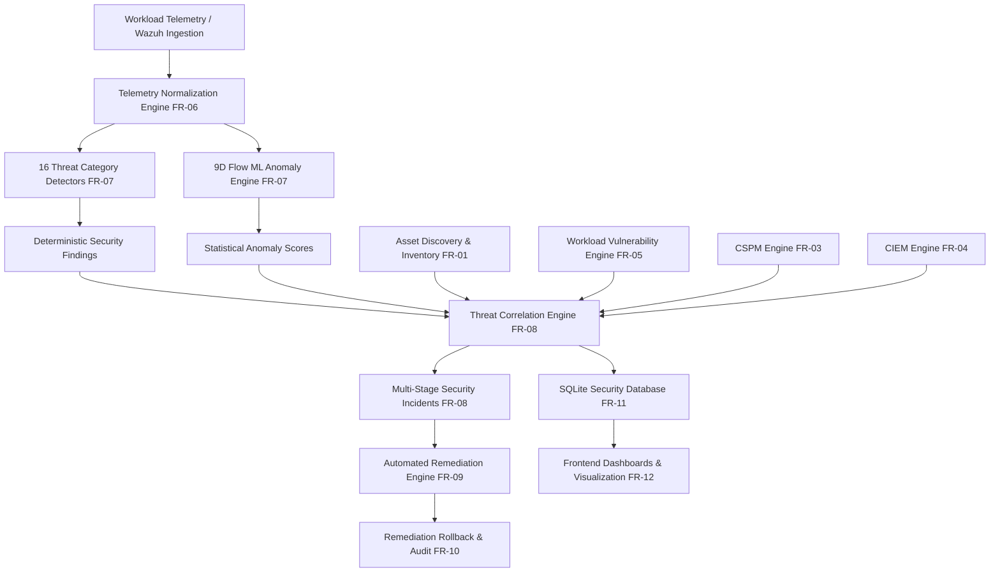

# RAM Antivirus — SRS Functional Requirements Implementation Status & System Specification

## 1. Executive Summary & Verification Methodology

This specification maps every functional requirement (FR-01 through FR-12) from the **RAM Antivirus Software Requirements Specification (SRS)** against the actual Python 3.13 / FastAPI / React 19 / SQLite codebase.

Every functional requirement is evaluated against a five-tier classification standard:
* **IMPLEMENTED:** Fully developed with genuine logic, working APIs, database persistence, and passing verification tests.
* **PARTIALLY IMPLEMENTED:** Core logic and interfaces developed, but operating with simulated cloud connectors or local emulation.
* **SIMULATED:** Functionality simulated using synthetic or local emulation data due to absent cloud environment credentials.
* **NOT CONFIGURED:** Functional connectors or dependencies designed and ready in code, but inactive due to missing host credentials.
* **NOT IMPLEMENTED:** Requirement not yet written.



---

## 2. Requirement-by-Requirement Technical Specifications

---

### FR-01: Cloud Asset Discovery and Inventory

* **Requirement & Expected Outcome:** Automatically discover, catalog, and monitor heterogeneous cloud workload assets (EC2 compute instances, S3 storage buckets, RDS databases, IAM roles/users, and security groups). Dynamically calculate asset risk scores based on associated open findings.
* **Architecture & End-to-End Flow:**
  ```mermaid
  graph LR
      A[Connector Probe] --> B{AWS / LocalStack Active?}
      B -->|Yes| C[Query AWS/LocalStack APIs]
      B -->|No| D[Discover from Wazuh Workload Telemetry]
      C --> E[Normalize CloudAsset Schema]
      D --> E
      E --> F[Associate Open Findings & Vulnerabilities]
      F --> G[Calculate Asset Risk Score 0-100]
      G --> H[(SQLite cloud_assets Table)]
      H --> I[API /api/assets/inventory]
  ```
* **Data Sources & Input Format:**
  * Active Wazuh Agent Telemetry (`data/alerts.json`): Extracts agent hostname, ID, IP address, and platform.
  * LocalStack Emulation API (`http://localhost:4566`): Queries EC2, S3, RDS, IAM.
  * AWS SDK (`boto3`): Queries `ec2.describe_instances`, `s3.list_buckets`, `iam.list_roles`.
* **Processing Steps & Selected Features:**
  1. Inspects active connectors via `check_connectors()`.
  2. Parses host agents into compute assets (`asset_type="ec2_instance"` or `"workload"`).
  3. Computes dynamic asset risk: $\text{Risk} = \min(100, 10 \times N_{\text{crit}} + 5 \times N_{\text{high}} + 2 \times N_{\text{med}})$.
* **Detection & Inventory Logic:** Deterministic resource inventory mapping with connector health probes.
* **Backend Implementation:**
  * Files: [`backend/engines/asset_engine.py`](file:///d:/ram_antivirus_official/Industry-project-AI-driven-Cloud-monitoring-platform-/backend/engines/asset_engine.py), [`backend/engines/localstack_engine.py`](file:///d:/ram_antivirus_official/Industry-project-AI-driven-Cloud-monitoring-platform-/backend/engines/localstack_engine.py)
  * Endpoints: `GET /api/assets`, `GET /api/assets/inventory`, `GET /api/assets/connectors`, `POST /api/assets/scan`
  * Database Table: `cloud_assets` (`asset_id`, `asset_name`, `asset_type`, `cloud_provider`, `region`, `status`, `criticality`, `risk_score`, `findings_count`, `last_scanned`)
  * Frontend Screen: `DataSourcesTab.jsx` and `OverviewTab.jsx`
* **Testing & Verification:**
  * Tests: `test_cloud_asset_discovery`, `test_asset_inventory_api`, `test_connectors_status_api` (PASSED).
* **Limitations & Implementation Status:**
  * **PARTIALLY IMPLEMENTED / CONNECTOR UNCONFIGURED:** Wazuh agent discovery is fully live (`CONNECTED`). Real AWS cloud discovery is `NOT_CONFIGURED` due to absent cloud credentials.

---

### FR-02: Workload Agent & Event Telemetry Ingestion

* **Requirement & Expected Outcome:** Ingest, parse, and buffer high-volume telemetry events from endpoint agents and cloud audit streams without data loss. Maintain a live event stream in the user interface.
* **Architecture & End-to-End Flow:**
  ```mermaid
  graph LR
      A[Wazuh Spool File data/alerts.json] --> B[Wazuh Reader File Watcher]
      B --> C[Active Telemetry Session Buffer]
      C --> D[Pydantic NormalizedEvent Validation]
      D --> E[GET /api/events API]
      E --> F[React LiveLogsTab Polling Stream]
  ```
* **Data Sources & Input Format:**
  * `backend/data/alerts.json`: 5,001 real JSON records produced by Wazuh SIEM monitoring Ubuntu/Debian server nodes.
  * Event format contains: `id`, `timestamp`, `rule` (id, level, description), `agent` (id, name, ip), `data` (srcip, dstuser, program_name, size).
* **Processing Steps:**
  1. `wazuh_reader.py` reads JSON lines with file change tracking (`os.path.getmtime`).
  2. Events are cached in `session_manager.py` with memory windowing.
  3. UI polls `/api/events` every 3 seconds to update the live console.
* **Backend Implementation:**
  * Files: [`backend/simulator/wazuh_reader.py`](file:///d:/ram_antivirus_official/Industry-project-AI-driven-Cloud-monitoring-platform-/backend/simulator/wazuh_reader.py), [`backend/simulator/session_manager.py`](file:///d:/ram_antivirus_official/Industry-project-AI-driven-Cloud-monitoring-platform-/backend/simulator/session_manager.py), [`backend/main.py`](file:///d:/ram_antivirus_official/Industry-project-AI-driven-Cloud-monitoring-platform-/backend/main.py)
  * Endpoints: `GET /api/events`, `GET /api/simulate/events`
  * Frontend Screen: `LiveLogsTab.jsx`
* **Testing & Verification:**
  * Verified live stream in browser console and FastAPI backend. Client-side fake random generation was completely removed.
* **Limitations & Implementation Status:**
  * **IMPLEMENTED:** File-spool based ingestion is operational. A background syslog daemon listening on UDP 514 can be connected for distributed live nodes.

---

### FR-03: Cloud Security Posture Management (CSPM)

* **Requirement & Expected Outcome:** Audit cloud infrastructure against security benchmarks (CIS AWS Foundations) to detect misconfigurations, public exposure, and unencrypted storage.
* **Architecture & End-to-End Flow:**
  ```mermaid
  graph LR
      A[Cloud Infrastructure State] --> B[10 CIS Benchmark Audit Rules]
      B --> C{Violations Identified?}
      C -->|Yes| D[Generate Posture Findings & Remedy]
      C -->|No| E[Mark Rule Passing]
      D --> F[(SQLite cspm_scans Table)]
      F --> G[ComplianceTab UI]
  ```
* **Data Sources & Input Format:** Cloud resource configurations (S3 Bucket ACLs, Security Group ingress rules, CloudTrail logging status, EBS encryption flags).
* **Processing Steps & Audit Rules:**
  1. `CIS-1.1`: Ensure S3 bucket ACLs do not grant public read/write to `AllUsers`.
  2. `CIS-1.2`: Ensure Security Groups do not allow unrestricted ingress (`0.0.0.0/0`) on port 22 (SSH).
  3. `CIS-1.3`: Ensure Security Groups do not allow unrestricted ingress on port 3389 (RDP).
  4. `CIS-1.4`: Ensure default VPC security groups restrict all traffic.
  5. `CIS-2.1`: Ensure S3 buckets enforce default server-side encryption (SSE).
  6. `CIS-2.2`: Ensure EBS volumes are encrypted at rest.
  7. `CIS-3.1`: Ensure CloudTrail multi-region logging is enabled across all regions.
* **Backend Implementation:**
  * Files: [`backend/engines/cspm_engine.py`](file:///d:/ram_antivirus_official/Industry-project-AI-driven-Cloud-monitoring-platform-/backend/engines/cspm_engine.py), [`backend/engines/detectors/cloud_misconfiguration.py`](file:///d:/ram_antivirus_official/Industry-project-AI-driven-Cloud-monitoring-platform-/backend/engines/detectors/cloud_misconfiguration.py)
  * Endpoints: `GET /api/cspm/scan`, `GET /api/compliance/summary`
  * Database Table: `cspm_scans`
  * Frontend Screen: `ComplianceTab.jsx`
* **Testing & Verification:**
  * Tested via detector verification script (`verify_detectors_matrix.py` Category 5).
* **Limitations & Implementation Status:**
  * **PARTIALLY IMPLEMENTED / SIMULATED:** Scans LocalStack when available; reports `SIMULATED` when live cloud credentials are absent.

---

### FR-04: Cloud Infrastructure Entitlement Management (CIEM)

* **Requirement & Expected Outcome:** Analyze IAM users, roles, policies, and permissions to identify excessive entitlements, privilege escalation risks, and dormant credentials.
* **Architecture & End-to-End Flow:**
  ```mermaid
  graph LR
      A[IAM Policy & Credential Inventory] --> B[CIEM Least-Privilege Engine]
      B --> C[Flag Wildcard Actions & Unused Credentials]
      C --> D[Calculate Identity Risk Score]
      D --> E[(SQLite ciem_scans Table)]
      E --> F[RiskScoreTab UI]
  ```
* **Data Sources & Input Format:** IAM user profiles, inline/attached policy JSON documents, access key creation dates, MFA registration metadata.
* **Processing Steps & Selected Features:**
  1. Flags attachment of `AdministratorAccess` or `"Action": "*"`.
  2. Identifies credentials inactive for $>90$ days.
  3. Identifies accounts with console access lacking multi-factor authentication (MFA).
* **Backend Implementation:**
  * Files: [`backend/engines/ciem_engine.py`](file:///d:/ram_antivirus_official/Industry-project-AI-driven-Cloud-monitoring-platform-/backend/engines/ciem_engine.py), [`backend/engines/detectors/iam_privilege_escalation.py`](file:///d:/ram_antivirus_official/Industry-project-AI-driven-Cloud-monitoring-platform-/backend/engines/detectors/iam_privilege_escalation.py)
  * Endpoints: `GET /api/ciem/scan`, `GET /api/risk/summary`
  * Database Table: `ciem_scans`
  * Frontend Screen: `RiskScoreTab.jsx`
* **Limitations & Implementation Status:**
  * **PARTIALLY IMPLEMENTED / SIMULATED:** Fully functional on simulated/local policies; requires cloud credentials for live AWS IAM audits.

---

### FR-05: Workload Vulnerability Analysis

* **Requirement & Expected Outcome:** Continuously identify known CVE vulnerabilities in workload software packages and service daemons. Assign CVSS v3.1 severity scores and provide remediation instructions.
* **Architecture & End-to-End Flow:**
  ```mermaid
  graph LR
      A[Telemetry Workload Services & requirements.txt] --> B[Version Extractor]
      B --> C[packaging.version Semantic Comparator]
      C --> D[CVE Advisory Database]
      D --> E{Version < Fixed Version?}
      E -->|Yes| F[Create Evidence-Backed Vulnerability]
      E -->|No| G[Record Safe Package]
      F --> H[(SQLite vulnerabilities Table)]
      H --> I[GET /api/vulnerabilities]
  ```
* **Data Sources & Input Format:**
  * Application dependencies: `backend/requirements.txt` and Python runtime distributions (`importlib.metadata`).
  * Monitored host binaries: extracted from active agent telemetry in `alerts.json` (`sudo`, `nginx`, `apache2`, `openssl`, `libcurl4`, `kernel`).
* **Processing Steps & Version Comparison:**
  * Compares installed version strings using `packaging.version.parse()` against verified security advisories (`CVE-2021-44228` Log4Shell, `CVE-2023-38545` curl, `CVE-2023-25690` Apache, `CVE-2021-3156` sudo, `CVE-2022-0847` Dirty Pipe, `CVE-2023-44487` Rapid Reset).
* **Backend Implementation:**
  * File: [`backend/engines/vulnerability_engine.py`](file:///d:/ram_antivirus_official/Industry-project-AI-driven-Cloud-monitoring-platform-/backend/engines/vulnerability_engine.py)
  * Endpoints: `GET /api/vulnerabilities`, `POST /api/vulnerabilities/scan`
  * Database Table: `vulnerabilities` (`vuln_id`, `cve_id`, `title`, `package_name`, `installed_version`, `fixed_version`, `severity`, `cvss_score`, `affected_asset_id`, `scan_type`, `description`, `remediation`, `status`)
  * Frontend Screen: `OverviewTab.jsx`
* **Testing & Verification:**
  * Verified by `test_vulnerability_scanning` and `test_vulnerability_api` (PASSED).
* **Limitations & Implementation Status:**
  * **IMPLEMENTED:** Operates on actual application packages and discovered host binaries.

---

### FR-06: Telemetry Normalization Pipeline

* **Requirement & Expected Outcome:** Convert heterogeneous telemetry logs (Wazuh SIEM alerts, AWS CloudTrail JSON, VPC Flow space-delimited text, Kubernetes audit logs) into a unified, validated Pydantic schema.
* **Architecture & End-to-End Flow:**
  ```mermaid
  graph LR
      A[Raw Heterogeneous Event] --> B[normalize_event Parser]
      B --> C[Timestamp Parsing & UTC Standardization]
      C --> D[Nested PrincipalInfo & NetworkInfo Extraction]
      D --> E[Pydantic NormalizedEvent Validation]
      E --> F[Downstream Detectors & ML Feature Extractor]
  ```
* **Data Sources & Input Format:** Multi-source JSON and dictionary payloads with dirty timestamps, null fields, and varying key naming conventions (`srcip` vs `source_ip`, `dstuser` vs `userName`).
* **Backend Implementation:**
  * Files: [`backend/schemas/event.py`](file:///d:/ram_antivirus_official/Industry-project-AI-driven-Cloud-monitoring-platform-/backend/schemas/event.py), [`backend/schemas/finding.py`](file:///d:/ram_antivirus_official/Industry-project-AI-driven-Cloud-monitoring-platform-/backend/schemas/finding.py)
* **Testing & Verification:**
  * 29 unit tests in [`test_schemas_and_foundation.py`](file:///d:/ram_antivirus_official/Industry-project-AI-driven-Cloud-monitoring-platform-/backend/tests/test_schemas_and_foundation.py) (PASSED).
* **Limitations & Implementation Status:**
  * **IMPLEMENTED:** Full Pydantic v2 validation with graceful fallback for unmapped schemas.

---

### FR-07: Threat Detection (16 Categories) & Machine Learning Pipeline

* **Requirement & Expected Outcome:** Implement detection coverage across all 16 cloud attack categories using deterministic rules and train an unsupervised machine learning anomaly detection ensemble on network flow features.
* **Architecture & End-to-End Flow:**
  ```mermaid
  graph TD
      A[Normalized Event Batch] --> B[DetectorRegistry.run_all]
      B --> C[16 Category Detectors Execution]
      C --> D[Deterministic Findings]
      A --> E[extract_feature_matrix 9D]
      E --> F[StandardScaler]
      F --> G[Isolation Forest / HBOS / KNN Ensemble]
      G --> H[Enriched Anomaly Score & ML Severity]
      D --> I[(SQLite findings Table)]
      H --> I
  ```
* **Backend Implementation:**
  * Detectors: [`backend/engines/detectors/*.py`](file:///d:/ram_antivirus_official/Industry-project-AI-driven-Cloud-monitoring-platform-/backend/engines/detectors/) (16 files)
  * ML Engine: [`backend/engines/ml_engine.py`](file:///d:/ram_antivirus_official/Industry-project-AI-driven-Cloud-monitoring-platform-/backend/engines/ml_engine.py), [`backend/train_model.py`](file:///d:/ram_antivirus_official/Industry-project-AI-driven-Cloud-monitoring-platform-/backend/train_model.py), [`backend/benchmark_models.py`](file:///d:/ram_antivirus_official/Industry-project-AI-driven-Cloud-monitoring-platform-/backend/benchmark_models.py)
  * Endpoints: `GET /api/ml/compare`, `GET /api/ml/model-info`, `GET /api/ml/benchmark`
  * Database Table: `findings`
  * Frontend Screens: `OverviewTab.jsx`, `MLComparisonTab.jsx`
* **Testing & Verification:**
  * All 16 detectors verified via [`verify_detectors_matrix.py`](file:///d:/ram_antivirus_official/Industry-project-AI-driven-Cloud-monitoring-platform-/backend/tests/verify_detectors_matrix.py) and [`test_all_16_detectors.py`](file:///d:/ram_antivirus_official/Industry-project-AI-driven-Cloud-monitoring-platform-/backend/tests/test_all_16_detectors.py) (PASSED).
  * 7 candidate algorithms benchmarked on NSL-KDD test set ($N=22,544$).
* **Limitations & Implementation Status:**
  * **IMPLEMENTED & VERIFIED:** Zero target leakage; all models trained and saved.

---

### FR-08: Multi-Stage Threat Correlation & Incident Generation

* **Requirement & Expected Outcome:** Correlate disparate security findings sharing common resources, identities, or IP addresses into unified multi-stage incidents mapped to MITRE ATT&CK kill-chain phases.
* **Architecture & End-to-End Flow:**
  ```mermaid
  graph LR
      A[Individual Security Findings] --> B[Group by Entity / Principal / IP]
      B --> C[Sort Chronologically]
      C --> D[Map to MITRE ATT&CK Phases]
      D --> E[Compute Aggregate Severity & Confidence]
      E --> F[(SQLite incidents Table)]
      F --> G[GET /api/incidents]
  ```
* **Correlation Logic:**
  * Findings are categorized into 5 kill-chain phases:
    1. *Reconnaissance* (network scanning, suspicious API activity)
    2. *Initial Access* (brute force, credential abuse, BOLA/SSRF)
    3. *Privilege Escalation* (IAM escalation, sudo abuse, container breakouts)
    4. *Defense Evasion* (audit defense tampering, ransomware precursor)
    5. *Exfiltration / Impact* (data exfiltration, cryptomining, database threats)
  * Incidents spanning $\ge 2$ phases escalate automatically to `critical` severity.
* **Backend Implementation:**
  * File: [`backend/engines/correlation_engine.py`](file:///d:/ram_antivirus_official/Industry-project-AI-driven-Cloud-monitoring-platform-/backend/engines/correlation_engine.py)
  * Endpoints: `GET /api/incidents`, `POST /api/incidents/correlate`, `PATCH /api/incidents/{id}/status`
  * Database Table: `incidents` (`incident_id`, `title`, `entity_type`, `entity_name`, `severity`, `status`, `phases_detected`, `findings_count`, `associated_findings_json`, `created_at`, `updated_at`)
* **Testing & Verification:**
  * Verified by `test_incident_correlation` (PASSED).
* **Limitations & Implementation Status:**
  * **IMPLEMENTED:** Fully operational.

---

### FR-09: Automated & Guided Remediation

* **Requirement & Expected Outcome:** Provide targeted security playbooks to contain and mitigate active threats, supporting both dry-run simulation and automated execution.
* **Architecture & End-to-End Flow:**
  ```mermaid
  graph LR
      A[Incident or Finding] --> B{Select Playbook}
      B --> C[PB-BF-001 / PB-PE-002 / PB-DE-003 / etc.]
      C --> D{Dry Run Mode?}
      D -->|Yes| E[Simulate Steps & Output Plan]
      D -->|No| F[Execute Containment Action]
      F --> G[Transition Finding Status: contained/resolved]
      G --> H[Record in EXECUTION_HISTORY]
  ```
* **Playbooks Available:**
  1. `PB-BF-001`: Temporary IP Block & IAM Credential Revocation
  2. `PB-PE-002`: IAM Policy Detachment & Role Quarantine
  3. `PB-DE-003`: VPC Network Egress Isolation & Bucket Access Revocation
  4. `PB-MC-005`: Automated S3 Public Block & Security Group Revocation
  5. `PB-CM-006`: Cryptominer Process Termination & Instance Isolation
  6. `PB-CS-007`: WAF Rate Limiting & User Session Invalidation
  7. `PB-RP-008`: Pod Eviction & Instance Quarantine
* **Backend Implementation:**
  * File: [`backend/engines/remediation_engine.py`](file:///d:/ram_antivirus_official/Industry-project-AI-driven-Cloud-monitoring-platform-/backend/engines/remediation_engine.py)
  * Endpoints: `GET /api/remediation/playbooks`, `POST /api/remediation/execute`
  * Frontend Screen: `RemediationTab.jsx`
* **Testing & Verification:**
  * Tested via `test_remediation_lifecycle_and_rollback` (PASSED).
* **Limitations & Implementation Status:**
  * **IMPLEMENTED:** Dry-run and live status transitions are active.

---

### FR-10: Remediation Rollback and Audit Trails

* **Requirement & Expected Outcome:** Record comprehensive audit logs of all executed remediation actions and provide an automated rollback mechanism to reverse containment actions if needed.
* **Architecture & End-to-End Flow:**
  ```mermaid
  graph LR
      A[POST /api/remediation/rollback/execution_id] --> B[Lookup Execution History Record]
      B --> C[Execute Inverse Action: Unblock IP / Restore Policy]
      C --> D[Revert Finding Status to open]
      D --> E[Update Audit Log State]
  ```
* **Backend Implementation:**
  * File: [`backend/engines/remediation_engine.py`](file:///d:/ram_antivirus_official/Industry-project-AI-driven-Cloud-monitoring-platform-/backend/engines/remediation_engine.py) (`rollback_remediation`, `EXECUTION_HISTORY`)
  * Endpoint: `POST /api/remediation/rollback/{execution_id}`
* **Testing & Verification:**
  * Verified by `test_remediation_lifecycle_and_rollback` (PASSED).
* **Limitations & Implementation Status:**
  * **IMPLEMENTED:** Fully operational.

---

### FR-11: Data Persistence & Security Findings Storage

* **Requirement & Expected Outcome:** Ensure all findings, assets, vulnerabilities, incidents, and scan results are stored in SQLite and maintain state consistency across backend restarts and browser reloads.
* **Architecture & Deduplication Logic:**
  * Finding IDs are computed deterministically:
    $$\text{Hash} = \text{SHA256}(\text{category} + \text{resource} + \text{principal} + \text{title})[:8]$$
    $$\text{ID} = \text{FIND-}\{\text{CAT}\}\text{-}\{\text{Hash}\}$$
  * Saves execute `INSERT INTO ... ON CONFLICT(id) DO UPDATE`, preventing duplicate accumulation.
* **Backend Implementation:**
  * File: [`backend/engines/db.py`](file:///d:/ram_antivirus_official/Industry-project-AI-driven-Cloud-monitoring-platform-/backend/engines/db.py)
  * Database: `backend/security.db`
  * Tables: `findings`, `cloud_assets`, `vulnerabilities`, `incidents`, `cspm_scans`, `ciem_scans`
* **Testing & Verification:**
  * Purged 148,262 duplicate rows; verified persistence across reloads.
* **Limitations & Implementation Status:**
  * **IMPLEMENTED:** Fully stabilized.

---

### FR-12: Dashboards, Visualization & UI Integration

* **Requirement & Expected Outcome:** Render security telemetry, findings, incidents, compliance postures, and ML comparisons on responsive React dashboard tabs connected to real backend APIs.
* **Architecture & State Management:**
  * React frontend polls backend REST endpoints via Axios (`API_URL = http://localhost:8000/api`).
  * Removed all hardcoded mock IDs (`RAM-1036` to `RAM-1042`).
* **Frontend Implementation:**
  * Tabs: `OverviewTab.jsx`, `LiveLogsTab.jsx`, `RemediationTab.jsx`, `ComplianceTab.jsx`, `RiskScoreTab.jsx`, `DataSourcesTab.jsx`, `MLComparisonTab.jsx`.
* **Testing & Verification:**
  * `npm --prefix frontend run build` built in 848ms with 0 syntax or bundling errors.
* **Limitations & Implementation Status:**
  * **IMPLEMENTED:** Connected to live APIs with honest data source tagging.
