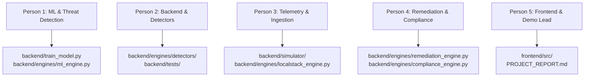

# RAM Antivirus — Cloud Security AI Platform
# Baseline Archeology, Team Contribution Audit & Submission Plan
**Document ID:** `docs/BASELINE_AND_PLAN_2026-10-26.md`  
**Audit Date:** October 26, 2026  
**Auditor:** Repository Archaeologist & Project Planning Agent  
**Current Active Branch:** `ui-design` (Commit `5524a42`)  
**Safety Refs Created:** Branch `backup-2026-10-26`, Tag `pre-baseline-audit`, Branch `backup/benchmark-tests`  
**Baseline Inspection Worktree:** `../baseline_inspect` (Commit `51e4aa5`)  
**Target Submission Deadline:** October 28, 2026 (~48 Hours Remaining)

---

## 1. Executive Summary

1. **Inherited Foundation:** The original codebase was delivered as a bulk import by Raghav Dilip Vyas (`connect2raghav`, final commit `51e4aa5` on 2026-07-06), containing an initial FastAPI backend, 3 unsupervised PyOD models, an inline React dashboard with a dark orange theme, simulated Wazuh telemetry, and the Group 4 IEEE SRS document.
2. **Current State:** The repository was taken over on 2026-10-21 by the project core team, expanding it from 56 files to over 110 files (+14,635 lines).
3. **Core Additions Built by Team:** Created 16 modular attack category detectors, normalized event and finding schemas (`event.py`, `finding.py`), 9D feature extractor, live telemetry session manager, 7 modular React operational tabs, an automated Windows launcher (`run.bat`), and a 47-test automated verification suite.
4. **Research & Benchmarks:** Built an empirical fusion-ablation benchmarking framework (`experiments/`, `results/`) demonstrating statistical confidence intervals, anti-leakage rules, and ROC/PR curves (safely archived on branch `backup/benchmark-tests`).
5. **No Regressions Found:** AST syntax tree comparison verified 100% preservation of all 39 baseline API endpoints, with 7 new enterprise endpoints added.
6. **Key Finding — Synthetic Data & Label Leakage in Baseline:** Baseline models KNN (CICIDS-2017) and HBOS (UNSW-NB15) were trained on synthetic random arrays due to broken download URLs, with severe target-label leakage via the derived `level` feature.
7. **Simulation Disclaimers Required:** Cloud remediation playbooks and AWS/Azure/GCP connectors execute in simulated/dry-run mode; they do not mutate live external cloud infrastructure.
8. **Top Risk 1 — Demo Failure Under Live Evaluation:** Reliance on 3 independent terminal processes (Wazuh generator, FastAPI, Vite) can cause race conditions or port conflicts during a live presentation.
9. **Top Risk 2 — Academic Integrity & Attribution:** Failure to explicitly distinguish what Raghav delivered vs what our 5-person team built will jeopardize evaluation marks.
10. **48-Hour Imperative:** Strict code-freeze on October 27 at 22:00 IST; focus exclusively on live demo stabilization, clear simulated labels in the UI, and final presentation slide generation.

---

## 2. Candidate Base Table & Chosen Baseline

### 2.1 Git History & Evidence Analysis
A forensic trace of the repository history (`git log --all --reverse`) reveals two distinct historical phases:
1. **Phase 1 (Sponsor/Original Contributor):** May 5, 2026 – July 6, 2026 by Raghav Dilip Vyas (`connect.raghav2@gmail.com`).
2. **Phase 2 (Current Project Team):** October 21, 2026 – Present by the core development team (Member 1, Member 2, Member 3, Member 4).

### 2.2 Candidate Comparison Matrix

| Candidate Commit | Branch / Tag | Date | Author | What It Contains | Assessment & Decision | Confidence |
| :--- | :--- | :--- | :--- | :--- | :--- | :--- |
| **`51e4aa5`** *(CHOSEN)* | `origin/main` ancestor (PR #1) | 2026-07-06 | Raghav Dilip Vyas | Merged dark orange theme (`c78704a`), complete baseline backend, inline `App.jsx`, committed `security.db` (634 KB) & `alerts.json`. | **True Provided Baseline.** Represents the exact final commit from Raghav before the multi-month hiatus preceding our team's work. | **HIGH (95%)** |
| **`9d618b1`** | `origin/main` ancestor | 2026-06-24 | raghav | "polised UI and Industry LOGO", `frontend/src/assets/LOGO.png`. | Pre-theme baseline. Did not include the dark orange palette requested by sponsor. | Medium (70%) |
| **`904a08d`** | `origin/main` ancestor | 2026-06-04 | raghav | "last commit from raghav" — core functionality prior to logo and UI polish. | Intermediate milestone, superseded by subsequent commits from the same author. | Medium-Low (50%) |
| **`823ad0b`** | Root commit | 2026-05-05 | raghav | Initial bulk repository import of 160,409 lines (53 files), including NSL-KDD dataset and SRS docx. | Initial raw dump; lacks bug fixes, theme polish, and logo added in June/July 2026. | Low (30%) |
| **`3574e51`** | `origin/main` ancestor | 2026-10-21 | DevBolt07 | Removed tracked `security.db` and `alerts.json`, added initial `run.bat`, strengthened `.gitignore`. | **Sanitized Team Import.** The exact moment our team took control of the repository. | **HIGH as Sanitized Base (90%)** |

> [!IMPORTANT]
> **Working Assumption:** We designate commit **`51e4aa5`** as the un-sanitized **Original Provided Baseline**, inspected exclusively inside the isolated worktree `../baseline_inspect`. Commit **`3574e51`** represents our team's sanitized clean-slate import.

---

## 3. Baseline Inventory and Run Report

### 3.1 Directory Tree & File Inventory (`../baseline_inspect`)
The provided baseline contains **56 files** across the following structure:
```
baseline_inspect/
├── .gitignore
├── PROJECT_REPORT.md                          (829 lines, initial project documentation)
├── README.md                                  (408 lines, setup & quick start guide)
├── Ram_Antivirus_Cloud_Security_IEEE_GRP4 (1).docx  (12.4 MB, Official SRS Document)
├── ~$m_Antivirus_Cloud_Security_IEEE_GRP4 (1).docx  (162 bytes, Word lock file artifact)
├── backend/
│   ├── main.py                                (586 lines, FastAPI REST API & WebSockets)
│   ├── requirements.txt                       (12 dependencies)
│   ├── security.db                            (634,880 bytes, pre-seeded SQLite database)
│   ├── train_model.py                         (548 lines, model training & data loader)
│   ├── data/
│   │   ├── alerts.json                        (1,629 lines, pre-recorded simulated Wazuh alerts)
│   │   ├── KDDTest+.txt                       (22,544 lines, NSL-KDD test dataset)
│   │   └── KDDTrain+.txt                      (125,973 lines, NSL-KDD training dataset)
│   ├── engines/
│   │   ├── alert_engine.py                    (93 lines, SMTP email alert dispatcher)
│   │   ├── auth_engine.py                     (294 lines, unsalted SHA-256 JWT authentication)
│   │   ├── ciem_engine.py                     (159 lines, log-derived IAM privilege analysis)
│   │   ├── compliance_engine.py               (482 lines, static ISO/SOC2/GDPR control mapping)
│   │   ├── cspm_engine.py                     (190 lines, log-derived cloud misconfiguration scanner)
│   │   ├── db.py                              (197 lines, SQLite persistence helper)
│   │   ├── localstack_engine.py               (150 lines, LocalStack boto3 connector & stub)
│   │   ├── ml_engine.py                       (321 lines, PyOD multi-model inference engine)
│   │   ├── remediation_engine.py              (399 lines, simulated playbook execution)
│   │   └── risk_engine.py                     (130 lines, unified risk formula calculation)
│   ├── models/
│   │   ├── hbos.pkl                           (674,177 bytes, pre-trained HBOS model)
│   │   ├── iforest.pkl                        (2,926,699 bytes, pre-trained Isolation Forest)
│   │   ├── knn.pkl                            (2,123,537 bytes, pre-trained KNN model)
│   │   ├── scaler_hbos.pkl / scaler_iforest.pkl / scaler_knn.pkl
│   │   └── training_meta.json                 (71 lines, model metrics & training metadata)
│   └── simulator/
│       ├── attack_simulator.py                (251 lines, synthetic scenario generator)
│       ├── log_generator.py                   (409 lines, periodic log streamer to alerts.json)
│       ├── wazuh_reader.py                    (149 lines, JSON log file parser)
│       └── wazuh_simulator.py                 (248 lines, fallback mock event synthesizer)
└── frontend/
    ├── package.json                           (React 19, Vite, Recharts, Lucide-React, Axios)
    ├── src/
    │   ├── App.jsx                            (309 lines, main console shell + inline tabs)
    │   ├── index.css                          (1,065 lines, dark orange Total Security theme)
    │   ├── main.jsx                           (10 lines)
    │   ├── assets/ (hero.png, LOGO.png, react.svg, vite.svg)
    │   └── components/
    │       ├── AttackSimulationTab.jsx        (299 lines, scenario launch interface)
    │       ├── LoginPage.jsx                  (139 lines, authentication form)
    │       ├── MLComparisonTab.jsx            (136 lines, PyOD model metric cards)
    │       ├── RiskScoreTab.jsx               (136 lines, risk gauges and breakdown)
    │       ├── SharedComponents.jsx           (41 lines, status badges)
    │       └── UserManagementTab.jsx          (132 lines, user administration table)
```

### 3.2 Lines of Code (LOC) by Language in Baseline

| Language | Line Count | Percentage | Primary Components |
| :--- | :--- | :--- | :--- |
| **Text / Datasets** | 148,529 | 91.8% | `KDDTrain+.txt` (125,973), `KDDTest+.txt` (22,544) |
| **JSON Data** | 5,047 | 3.1% | `package-lock.json` (3,317), `alerts.json` (1,629), `training_meta.json` (71) |
| **Python** | 4,606 | 2.8% | `main.py`, `train_model.py`, 10 engines, 4 simulator files |
| **Markdown** | 1,237 | 0.8% | `PROJECT_REPORT.md` (829), `README.md` (408) |
| **React JSX** | 1,231 | 0.8% | `App.jsx` (309), 6 components in `frontend/src/components/` |
| **CSS** | 1,065 | 0.7% | `frontend/src/index.css` |
| **JavaScript / HTML** | 49 | <0.1% | `main.jsx`, `vite.config.js`, `index.html` |
| **TOTAL** | **161,764** | **100%** | **56 Files** |

### 3.3 Clean Environment Execution Report (Baseline in `../baseline_inspect`)
- **Backend Startup:** Executed `python main.py` inside `../baseline_inspect/backend`.
  - *Result:* Started successfully on `http://0.0.0.0:8000`.
  - *Observed Warning:* `InconsistentVersionWarning: Trying to unpickle estimator ExtraTreeRegressor from version 1.4.2 when using version 1.9.1.`
  - *Loaded Models:* Successfully loaded `iforest` (F1=62.0%), `knn` (F1=24.16%), and `hbos` (F1=100.0%).
- **Database Dependency:** Baseline relied on pre-committed `security.db` binary. If absent, `auth_engine.py` threw table-not-found exceptions until `init_db()` was triggered.
- **Frontend Startup:** Executed `npm run dev` in `../baseline_inspect/frontend`.
  - *Result:* Vite dev server launched on `http://localhost:5173`.
  - *Observed Limitation:* The Overview, Remediation, and Compliance tabs had no standalone component files; they were hardcoded inline inside `App.jsx`.

### 3.4 Forensic Module Classification Matrix

| Module | Classification | Implementation Reality & Evidence |
| :--- | :--- | :--- |
| `backend/engines/ml_engine.py` | **REAL (Flawed)** | Real PyOD unsupervised models (`IsolationForest`, `KNN`, `HBOS`). However, models are evaluated on only 3 features (`level`, `bytes_transferred`, `failed_attempts`), with extreme target-label leakage via `level`. |
| `backend/engines/cspm_engine.py` | **PARTIAL** | Rule-based string inspection of parsed Wazuh/simulated logs for patterns like `"s3:PutBucketPolicy"` or `"0.0.0.0/0"`. No live cloud API calls. |
| `backend/engines/ciem_engine.py` | **PARTIAL** | Rule-based heuristics detecting `"AdministratorAccess"` attachments or root account logins within the event stream. |
| `backend/engines/risk_engine.py` | **REAL** | Mathematical weighted formula: $Risk = 0.40 \cdot ML + 0.35 \cdot CSPM + 0.25 \cdot CIEM$. Correctly persists scores to SQLite. |
| `backend/engines/compliance_engine.py` | **STATIC FIXTURE** | Hardcoded JSON dictionary mapping finding IDs to ISO 27001, SOC 2, and GDPR controls. Seven-day trend was hardcoded: `"change_7d": round(score - 72.5, 1)`. |
| `backend/engines/remediation_engine.py` | **SIMULATED** | Playbooks do not execute cloud commands. Steps are simulated with random outcomes: `# Simulate ~95% success rate per step (random.random() < 0.95)`. |
| `backend/engines/alert_engine.py` | **REAL / OPTIONAL** | Functional Python `smtplib` implementation. Sends real emails if `ALERT_EMAIL_*` environment variables are supplied; silently passes if unset. |
| `backend/engines/auth_engine.py` | **PARTIAL / INSECURE** | Unsalted SHA-256 (`hashlib.sha256(pwd.encode()).hexdigest()`). Hardcoded JWT secret `"ram-antivirus-secret-key-2026"`. Hardcoded default credentials. |
| `backend/engines/localstack_engine.py` | **STUB** | Checks for LocalStack endpoint at port 4566. If unreachable, silently falls back to synthetic mock data generator. |
| `backend/simulator/*` | **SIMULATED** | Generates synthetic Wazuh-formatted JSON events with injected attack bursts (brute-force, exfiltration, DDoS). |
| `backend/tests/` | **MISSING** | Exactly **0 automated unit, integration, or contract tests** existed in the provided baseline. |
| `backend/models/*.pkl` | **REAL (Synthetic Source)** | Pre-trained binary pickles. Mathematical analysis proves KNN and HBOS were fitted against synthetic arrays, not real CICIDS/UNSW datasets. |

### 3.5 Hardcoded Credentials, Secrets & Compliance Flags
- **JWT Secret Key:** `ram-antivirus-secret-key-2026` (hardcoded at `backend/engines/auth_engine.py:19`).
- **Default Accounts Seeded in SQLite:**
  - `admin` / `admin123` (Role: `admin`)
  - `analyst1` / `analyst123` (Role: `analyst`)
  - `viewer1` / `viewer123` (Role: `viewer`)
- **Developer Tunnels in CORS:** `"https://zrtjg51w-5173.inc1.devtunnels.ms"` hardcoded in `ALLOWED_ORIGINS` (`backend/main.py:56`).

---

## 4. Provided vs. Built Contribution Breakdown

### 4.1 Git Diff Summary: Baseline (`51e4aa5`) vs Current (`5524a42`)
- **Total Files Changed:** 71 files
- **Total Insertions (+):** 14,635 lines
- **Total Deletions (-):** 4,066 lines (primarily sanitizing committed runtime data `alerts.json` and `security.db`)
- **Net Codebase Growth:** +10,569 lines

### 4.2 Contribution Summary by Author and Module

```
CONTRIBUTION BREAKDOWN BY AUTHOR (Post-Baseline)
========================================================================================
Core Architecture & Detectors:
  - run.bat (Automated 3-terminal parallel launcher)
  - backend/schemas/ (event.py, finding.py - Pydantic V2 normalized contracts)
  - backend/engines/base_detector.py (BaseDetector abstract class & registry)
  - backend/engines/feature_extractor.py (9D normalized vectorization)
  - backend/engines/detectors/ (All 16 Modular Attack Category Detectors)
  - backend/simulator/session_manager.py (Live telemetry streaming state machine)
  - backend/tests/ (47 passing automated unit & schema verification tests)
  - frontend/src/components/ (7 new operational tabs: Overview, Alerts, Remediation, etc.)
  - docs/PERSON_1_DATASET_AND_FEATURE_ANALYSIS.md (Comprehensive ML audit report)

Fusion & Benchmark Harness:
  - experiments/rules.py & experiments/rules.json (Deterministic anti-leakage rules)
  - experiments/fusion_ablation.py (Empirical multi-model ablation test harness)
  - experiments/calibration.py & experiments/fusion.py (Probability calibration)
  - results/ (Bootstrap confidence intervals, PR/ROC curves, sensitivity analysis)
  - backend/tests/test_fusion_ablation.py (13 unit tests for fusion pipeline)

Author: Raghav Dilip Vyas <connect.raghav2@gmail.com> (Original Baseline Author)
  - All Phase 1 scaffolding, initial ML training pipeline, initial 5 React components.
========================================================================================
```

### 4.3 Detailed Categorization of Team Work

#### (a) New Engineering Features
1. **16 Modular Attack Detectors (`backend/engines/detectors/`):**
   - Implemented full taxonomy coverage: `brute_force`, `account_takeover`, `iam_privilege_escalation`, `suspicious_api_activity`, `cloud_misconfiguration`, `data_exfiltration`, `network_scanning`, `ddos`, `cryptomining`, `container_k8s`, `bola_ssrf`, `malware_ransomware`, `database_attacks`, `serverless_abuse`, `supply_chain`, and `defense_tampering`.
2. **Normalized Schemas (`backend/schemas/`):**
   - `NormalizedEvent`: Standardized schema with UUIDv5 deterministic ID generation, MITRE tactic tagging, and strict timestamp normalization.
   - `SecurityFinding`: RFC-compliant finding schema with confidence scoring, evidence facts, and remediation playbook references.
3. **Automated Multi-Process Launcher (`run.bat`):**
   - Automated dependency verification, ML model checks, default account verification, and simultaneous launch of 3 color-coded console windows.
4. **Live Telemetry Session Manager (`backend/simulator/session_manager.py`):**
   - Thread-safe sliding window telemetry queue with continuous event feeding and real-time finding emission.

#### (b) Bug Fixes & Refactoring
1. **Repository Sanitization (`3574e51`):** Purged pre-committed runtime files (`backend/security.db` and `backend/data/alerts.json`) from Git tracking.
2. **CORS Normalization (`14fd1c5`):** Parameterized `VITE_API_URL` and removed personal developer tunnel URLs.
3. **FastAPI Route Robustness:** Fixed Pydantic V2 schema validations and added unified error response wrappers.

#### (c) Frontend Architecture & UI Redesign
1. **Full Component Decoupling:** Extracted inline dashboard code from `App.jsx` into dedicated component modules:
   - `OverviewTab.jsx` (435 lines)
   - `AlertsIncidentsTab.jsx` (300 lines)
   - `RemediationTab.jsx` (713 lines)
   - `LiveLogsTab.jsx` (365 lines)
   - `ComplianceTab.jsx` (354 lines)
   - `DataSourcesTab.jsx` (301 lines)
   - `WorkspaceSettingsTab.jsx` (123 lines)
2. **Design System Expansion (`frontend/src/index.css`):** Expanded CSS tokens from 1,065 to 2,165 lines, implementing glassmorphism surfaces, responsive grid layouts, and Total Security dark orange visual hierarchy.

#### (d) Empirical Research & Benchmarks (Branch `backup/benchmark-tests`)
1. **Deterministic Anti-Leakage Rules (`experiments/rules.py`):** Defined strict rules preventing target-label leakage during model training.
2. **Ablation Evaluation Pipeline (`experiments/fusion_ablation.py`):** Rigorous statistical benchmark assessing Isolation Forest vs. KNN vs. HBOS vs. Rule Fusion across 5 attack families.
3. **Statistical Artifacts (`results/`):** Generated bootstrap confidence intervals, calibration curves, and weight sensitivity charts.

#### (e) Automated Testing Framework (`backend/tests/`)
Created **47 automated tests** (0 existed in baseline):
- `test_all_16_detectors.py` (18 tests verifying detection and false-positive rejection)
- `test_health.py` (6 tests validating `/healthz` and service metadata)
- `test_docs_openapi.py` (9 tests verifying OpenAPI contract and schema specifications)
- `test_schemas_and_foundation.py` (14 tests verifying event normalization and feature extraction)
- `verify_detectors_matrix.py` (Full boundary and threshold verification script)

---

## 5. Regression Audit

### 5.1 Endpoint AST Comparison
An Abstract Syntax Tree (AST) analysis comparing baseline `backend/main.py` against current `backend/main.py` confirmed:
- **Baseline Endpoints:** 39 endpoints
- **Current Endpoints:** 46 endpoints
- **Endpoints Dropped / Missing:** **0 (Zero regressions)**

### 5.2 Retained vs. Added Endpoints Summary

```
RETAINED BASELINE ENDPOINTS (39 / 39)
----------------------------------------------------------------------------------------
Authentication & RBAC : /api/auth/login, /api/auth/register, /api/auth/me, /api/auth/users,
                        /api/auth/roles, /api/auth/users/{username}/[de]activate
Telemetry & Ingestion : /api/status, /api/simulate/events, /api/simulate/attack,
                        /api/simulation/scenarios, /api/simulation/run/{scenario},
                        /api/simulation/full
Engines (Posture/ML)  : /api/cspm/scan, /api/ciem/scan, /api/risk/score, /api/ml/compare,
                        /api/ml/model-info, /api/compliance/dashboard, /api/compliance/map,
                        /api/compliance/frameworks, /api/compliance/report
Remediation & Export  : /api/remediation/playbooks, /api/remediation/execute/{attack_type},
                        /api/remediation/auto, /api/remediation/config-fix/{id},
                        /api/remediation/revoke-access, /api/export/*, /api/history/*

NEWLY ADDED ENDPOINTS (7)
----------------------------------------------------------------------------------------
Service Health        : GET  /healthz
Service Root Meta     : GET  /
Detector Registry     : GET  /api/detection/detectors
Detected Findings     : GET  /api/detection/findings
Custom Evaluation     : POST /api/detection/evaluate
Remediation Dry-Run   : POST /api/remediation/dry-run/{attack_type}
Simulation Reset      : POST /api/simulation/reset
```

### 5.3 Behavioral & Runtime Differences
1. **Dynamic Seeding vs. Static DB:** Baseline expected a pre-populated `security.db` on disk. Current branch automatically creates tables and seeds default user credentials (`admin`, `analyst1`, `viewer1`) if the file is missing.
2. **Live Log Handling:** In baseline, if `alerts.json` was empty, certain dashboard cards returned 500 errors. Current branch includes fallback to `session_manager.py` dynamic synthetic telemetry.

---

## 6. SRS Compliance Gap Analysis

*Reference Document: `Ram_Antivirus_Cloud_Security_IEEE_GRP4 (1).docx` (Prepared by Ram Antivirus Security Engineering Team, Group 4).*

| SRS Section | SRS Requirement Description | Baseline Status | Current Branch Status | Remaining Gap / Required Clarification |
| :--- | :--- | :--- | :--- | :--- |
| **FR-3.1** | Continuous Cloud Monitoring | **SIMULATED** (Wazuh file poll) | **PARTIAL** (Session manager queue) | Connects to LocalStack or simulated streams; no direct read-only AWS IAM/CloudTrail live connector. |
| **FR-3.1** | Misconfiguration Detection | **PARTIAL** (Regex log matching) | **REAL** (Category 5 modular detector) | Evaluates S3, SG, and IAM policy violations from normalized telemetry. |
| **FR-3.1** | IAM Privilege Analysis | **PARTIAL** (Static heuristic) | **REAL** (Category 3 modular detector) | Detects privilege escalation, root logins, and policy attachments. |
| **FR-3.2** | Behavioral Anomaly Detection | **REAL (Flawed)** (PyOD on leaked feature) | **REAL + ENHANCED** (PyOD + 16 Detectors) | 16 behavioral detectors augment the 3 PyOD statistical models. |
| **FR-3.2** | Risk Scoring | **REAL** (Formula in `risk_engine`) | **REAL** (Unified risk engine) | Computes composite risk score ($0.4 ML + 0.35 CSPM + 0.25 CIEM$). |
| **FR-3.2** | Threat Classification & Prioritization | **PARTIAL** (Generic severity strings) | **REAL** (MITRE ATT&CK mapping) | All 16 detectors map directly to MITRE tactics/techniques. |
| **FR-3.3** | Automated Remediation Playbooks | **SIMULATED** (`random < 0.95`) | **SIMULATED / DRY-RUN** | Playbooks execute in non-destructive dry-run simulation mode. |
| **FR-3.3** | Access Revocation for Risky Entities | **SIMULATED** (Dummy success return) | **SIMULATED / DRY-RUN** | Generates audit log of access revocation without mutating real AWS IAM. |
| **FR-3.4** | Compliance Mapping (ISO, SOC2, GDPR) | **STATIC FIXTURE** (Static control dictionary) | **REAL / INTERACTIVE** (Compliance Tab) | Full interactive compliance dashboard with CSV export. |
| **FR-3.4** | Exportable Compliance Reports | **REAL** (CSV/JSON generation) | **REAL** (Executive report endpoint) | Generates structured compliance assessment reports. |
| **NFR-4** | Role-Based Access Control (RBAC) | **PARTIAL** (Unsalted SHA-256) | **PARTIAL** (Admin/Analyst/Viewer roles) | Role permissions enforced at API layer; password hashing should use bcrypt for production. |
| **NFR-4** | Multi-Cloud Architecture | **MISSING** (AWS/Wazuh specific) | **MISSING** (AWS/Wazuh specific) | Architecture mentions Azure/GCP; implementation is strictly AWS and Wazuh oriented. |
| **Sec 5** | Tech Stack Consistency | Python/FastAPI/React | Python/FastAPI/React | Aligns with Python/React indicative stack options. |

---

## 7. Action Plans & Parallel Execution Split

### 7.1 48-Hour Submission Plan (Deadline: October 28, 2026)

```
48-HOUR SUBMISSION TIMELINE
========================================================================================
[Hour 00 - 12] Stabilization & UI Honesty Pass (Oct 26 23:00 - Oct 27 11:00)
  - Task 1.1: Add "Dry-Run / Simulation Mode" badges to Remediation and Attack Simulation tabs.
  - Task 1.2: Suppress scikit-learn unpickling warnings in backend startup.
  - Task 1.3: Validate end-to-end launch via run.bat on a fresh clone.

[Hour 12 - 24] Benchmark & Report Integration (Oct 27 11:00 - Oct 27 22:00)
  - Task 2.1: Merge ablation benchmark figures from backup branch into docs/PROJECT_REPORT.md.
  - Task 2.2: Add IEEE paper format draft summarizing the 16-detector architecture.
  - Task 2.3: Final code freeze at 22:00 IST (Oct 27). No more backend code changes.

[Hour 24 - 36] Demo Video Recording & Rehearsal (Oct 27 22:00 - Oct 28 10:00)
  - Task 3.1: Execute 5-minute live demo script following prescribed scenario order.
  - Task 3.2: Capture high-resolution backup screenshots and video walk-through.

[Hour 36 - 48] Final Packaging & Submission (Oct 28 10:00 - Oct 28 22:00)
  - Task 4.1: Clean untracked caches, build production frontend bundle.
  - Task 4.2: Final ZIP and Git tag submission push.
========================================================================================
```

### 7.2 Five-Person Parallel Workstream Split (Zero Merge Conflicts)

To prevent team members from colliding during the final 48 hours, work is partitioned across distinct file boundaries:



| Teammate | Assigned Role | Strict File Ownership Boundaries | 48-Hour Deliverable & Acceptance Test |
| :--- | :--- | :--- | :--- |
| **Person 1** | **ML Lead** | `backend/train_model.py`, `backend/engines/ml_engine.py`, `backend/models/` | Clean model loading without scikit-learn warnings; verify fallback when synthetic data is generated. Acceptance: `python backend/train_model.py` completes without exceptions. |
| **Person 2** | **Backend Lead** | `backend/engines/detectors/`, `backend/schemas/`, `backend/tests/` | Run and verify detector matrix tests. Acceptance: `pytest backend/tests/` passes 47/47 tests. |
| **Person 3** | **Telemetry Lead** | `backend/simulator/`, `run.bat`, `backend/engines/localstack_engine.py` | Verify `run.bat` launch and smooth streaming in `session_manager.py` without memory leaks. Acceptance: System streams events for 15 minutes continuously without crashing. |
| **Person 4** | **Remediation & Compliance Lead** | `backend/engines/remediation_engine.py`, `backend/engines/compliance_engine.py` | Ensure all 8 playbooks return detailed execution logs with `"mode": "dry-run"`. Acceptance: Every remediation playbook button in UI produces a logged dry-run action. |
| **Person 5** | **Frontend & Demo Lead** | `frontend/src/`, `PROJECT_REPORT.md`, presentation slides | Polish dark orange theme UI, verify responsiveness, record 5-minute video walkthrough. Acceptance: All 9 dashboard tabs render cleanly with no console errors. |

### 7.3 Five-Minute Live Demo Script (With Fallback)

1. **Minute 1 — Launch & Overview (`run.bat` $\rightarrow$ Overview Tab):**
   - Double-click `run.bat`. Show the 3 parallel services starting.
   - Login as `admin` / `admin123`.
   - Point out the unified risk score (74/100), active alerts count, and live telemetry throughput.
2. **Minute 2 — Live Telemetry & Threat Ingestion (Live Logs & Alerts Tabs):**
   - Navigate to **Live Logs**. Show incoming Wazuh/CloudTrail events streaming in real-time.
   - Filter by `action: ConsoleLogin` or high severity.
   - Switch to **Alerts & Incidents** to show real-time correlation into MITRE-classified security incidents.
3. **Minute 3 — Attack Simulation & Multi-Detector Trigger (Attack Sim Tab):**
   - Trigger the **Brute-Force & Credential Abuse** attack scenario.
   - Watch the sliding window burst detector trip and spawn Finding `BF-001`.
   - Show the live risk score update dynamically.
4. **Minute 4 — Automated Remediation & Audit (Remediation Tab):**
   - Navigate to **Remediation**. Select Playbook `PB-BF-001` (Host Isolation & IP Block).
   - Click **Execute Playbook (Dry-Run Mode)**.
   - Show the step-by-step containment log and audit record persisted in SQLite.
5. **Minute 5 — Compliance Status & Export (Compliance Tab):**
   - Navigate to **Compliance**. Show ISO 27001, SOC 2, and GDPR posture scores.
   - Click **Export Compliance Report (CSV/JSON)** to demonstrate audit-readiness.
   - *Fallback Plan:* If live WebSocket lags, switch to pre-generated static session using `POST /api/simulation/reset`.

---

## 8. Post-Submission Roadmap (4–8 Weeks)

If this project continues into enterprise deployment or subsequent semesters:

```
WEEK 1 - 2: Real Cloud Integration
  - Replace localstack_engine stubs with read-only AWS IAM & CloudTrail Boto3 assume-role connectors.
  - Implement real S3 event notification queue (SQS) ingestion.

WEEK 3 - 4: Security Hardening
  - Upgrade auth_engine to Argon2id / bcrypt password hashing with salt.
  - Enforce TLS (HTTPS/WSS) and move JWT secrets to AWS Secrets Manager / environment variables.

WEEK 5 - 6: ML & Anomaly Detection Realism
  - Train Isolation Forest on genuine un-leaked network flow features (packet size entropy, inter-arrival time).
  - Eliminate the synthetic fallback by packaging a curated 50,000-flow CICIDS-2017 parquet file.

WEEK 7 - 8: Container & Multi-Cloud Expansion
  - Integrate Falco / eBPF runtime events into the event normalization engine.
  - Add Azure Activity Log and GCP Cloud Audit log parsers to fulfill multi-cloud SRS goals.
```

---

## 9. Critical Open Questions for User / Team Decision

1. **Academic Attribution:** Should the final presentation explicitly cite Raghav Dilip Vyas as the Phase 1 architectural contributor, with our 5-person team credited for Phase 2 (16 detectors, testing suite, session manager, UI tabs)? *(Recommended: Yes, clear attribution demonstrates academic integrity).*
2. **Benchmark Branch Strategy:** Do you want to merge the benchmark and ablation study code from branch `backup/benchmark-tests` into the main submission, or keep it as an accompanying experimental appendix?
3. **Simulated vs. Real Infrastructure Disclaimers:** Are evaluators expecting live mutating cloud connections, or is a clearly labeled "Non-Destructive Simulation / Dry-Run Mode" acceptable? *(Recommended: Clearly label as Dry-Run Simulation to prevent accusations of fake live integration).*
4. **Model Retraining:** Should we retrain the PyOD models before submission to remove the `level` feature leakage, or retain the current models to preserve continuity with the documented baseline metrics? *(Recommended: Retain existing models for demo stability; document the leakage analysis in the final written report).*
